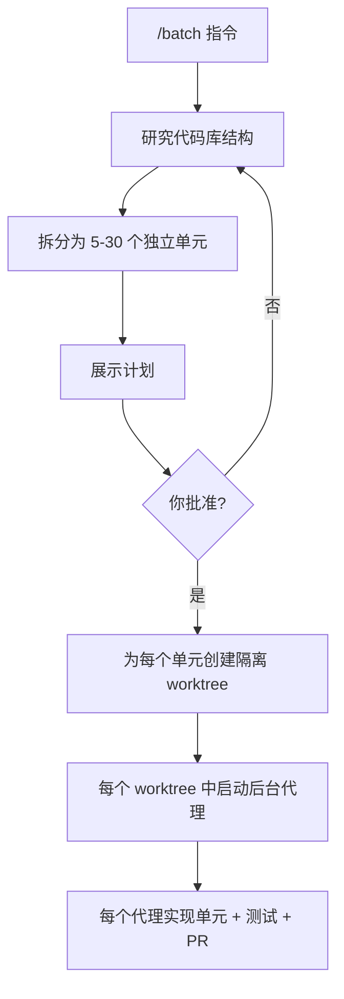

# Worktrees 与并行会话

## 为什么需要并行会话

单个 Claude Code 会话在长时间任务中会遇到两个根本瓶颈：**时间**（任务只能串行执行）和**上下文污染**（越往后上下文越膨胀、质量越下降）。

Anthropic 内部团队和社区重度用户的核心实践是：**同时运行 3-5 个 Claude Code 会话**，每个在独立的 Git Worktree 中，各司其职。

## Git Worktree 基础

Git Worktree 允许你在同一个仓库中同时检出多个分支到不同目录，每个目录有独立的工作区。

```shell
# 创建一个新的 worktree
git worktree add ../project-auth auth-feature

# 列出所有 worktree
git worktree list

# 删除 worktree
git worktree remove ../project-auth
```

## Claude Code 的 Worktree 支持

### 启动方式

```shell
# 自动创建并启动
claude --worktree

# 指定 worktree 名称
claude --worktree my_worktree

# 配合 tmux
claude --worktree --tmux
```

在 Desktop App 中打开 Code 标签页并勾选 worktree 复选框。

### 作用

- 每个 Claude 会话在**完全隔离的工作目录**中运行
- 互不干扰的文件修改
- 并行执行独立任务
- 不会相互污染上下文

## 并行会话实操

### 工作台布局

来自 Boris Cherny 和 Anthropic 内部团队的模式：

```
Terminal Tab 1 [红色]  → claude --worktree feature-a (Opus, xhigh, Plan Mode)
Terminal Tab 2 [蓝色]  → claude --worktree feature-b (Opus, 执行模式)
Terminal Tab 3 [绿色]  → claude --worktree review   (Sonnet, Code Review)
Terminal Tab 4 [黄色]  → claude --worktree analysis (Haiku, 日志分析)
Terminal Tab 5 [紫色]  → claude --worktree refactor (Opus, Auto Mode)
```

### Shell 别名

```bash
# .zshrc
alias ca='claude --worktree'
alias za='cd ~/worktrees/$(ls -t ~/worktrees/ | head -1)'  # 跳转最新 worktree
```

### 多终端管理

- **颜色标记**：每个终端 Tab 使用不同颜色标识
- **通知开启**：在终端中启用通知，任何 Claude 需要关注时都能看到
- **专用 worktree**：保留一个专门的 "analysis" worktree 用于读取日志和查询

### 非 Git 版本控制系统

对于 Mercurial / Perforce / SVN 用户，通过 `WorktreeCreate` 和 `WorktreeRemove` Hook 实现同等隔离效果。

## `/batch` 命令

对于大规模迁移任务，使用 `/batch` 命令：

```
/batch migrate src/ from Solid to React
```

`/batch` 的工作流程：



## 会话管理

### 命名会话

```shell
claude --name "auth-refactor" --worktree
```

Plan Mode 下 Claude 会基于工作内容自动命名。

### 查找会话

```shell
# 在 Desktop App / Web 中查看
claude agents
```

v2.1.158 起提供 Agent View——所有会话（运行中、等待你、已完成）的统一列表。

### Teleport

在不同环境间迁移会话：

```shell
# 从 Web 拉回本地终端
claude --teleport

# 从终端传到 Desktop App
/desktop
```

## 最佳实践

1. **任务边界清晰**：给每个并行会话一个明确的、独立的目标
2. **避免文件冲突**：不要让两个会话同时修改相同文件
3. **Plan 先行**：复杂任务先在 Plan Mode 中验证方案再并行执行
4. **从一个会话开始**：当子任务自然独立时再拆分并行
5. **定期检查**：同时跑多个会话时，定期巡视每个会话的进展

> **资料来源**：[Claude Code Power User Tips](https://support.claude.com/en/articles/14554000-claude-code-power-user-tips)、[Common Workflows](https://code.claude.com/docs/en/common-workflows)
