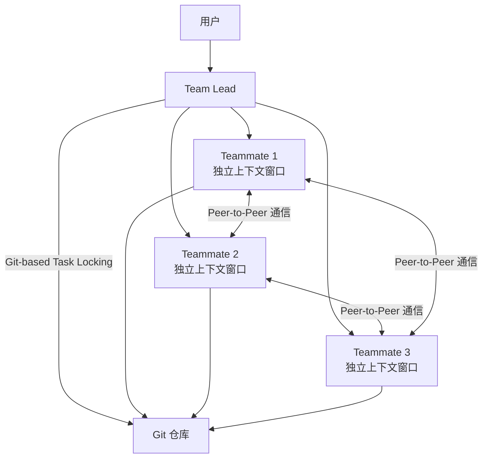

# Agent Teams

## 什么是 Agent Teams

Agent Teams（代理团队）是 Claude Code 的研究预览特性，允许多个 Claude Code 实例作为团队协同工作——一个会话作为 **Team Lead** 协调工作、分配任务、综合结果，**Teammates** 各自独立运行、互相通信。

与 Subagent 的关键区别：
- Subagent 只能向主代理报告结果，无法与其他 Subagent 通信
- Agent Teams 中 Teammate 之间可以**点对点直接通信**
- Agent Teams 通过 Git-based Locking 机制协调任务

## 启用

Agent Teams 是实验性功能，默认关闭：

```shell
export CLAUDE_CODE_EXPERIMENTAL_AGENT_TEAMS=1
```

或在 `settings.json` 中设置。

需要 **Opus 4.6+** 模型。

## 架构



关键机制：
- **Team Lead** 分解任务、分配、综合结果
- **Git-based Locking**：Teammate 通过写入共享目录来认领任务
- **Continuous Merge**：变更持续拉取/推送，无需人工介入
- **Peer-to-Peer Messaging**：Teammate 之间直接通信

## 核心交互流程

1. 用户向 Team Lead 描述总体目标
2. Team Lead 制定计划、分解任务
3. Team Lead 将任务写入共享 Git 工作区
4. Teammate 认领任务（Git Locking）
5. Teammate 在独立上下文中执行任务
6. Teammate 之间通过 mailbox 通信
7. 变更持续合并到共享分支
8. Team Lead 综合结果并汇报

## 最佳实践

### 开始前

1. **从研究和审查开始**：不涉及代码编写的任务（PR 审查、库研究、Bug 调查）是入门 Agent Teams 的最佳方式
2. **给 Teammate 充足的上下文**：任务描述需包含文件路径、约束、验收标准

### 任务粒度

- **避免文件冲突**：不同 Teammate 应各自处理一套独立的文件
- **合理团队规模**：从 2-3 个 Teammate 起步，逐步扩展
- **任务粒度适当**：太细的任务协调开销大，太粗的任务不够并行

### 执行中

- **监控和引导**：定期检查各 Teammate 进展
- **Plan Approval**：可要求 Teammate 在执行前请求计划审批
- **关注 Token 消耗**：多个同时运行的模型调用意味着更高的成本

## 已知限制

- 实验性功能，稳定性不保证
- 会话恢复可能丢失协调状态
- 存在孤儿 tmux 会话的风险
- 任务协调和关闭行为有已知问题

> **资料来源**：[Claude Code 官方文档 - Agent Teams](https://code.claude.com/docs/en/agent-teams)
