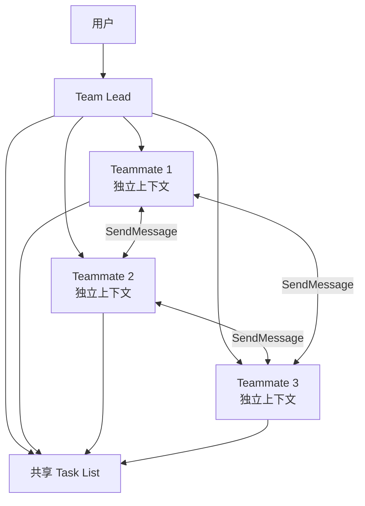

# Agent Teams

## 什么是 Agent Teams

Agent Teams（代理团队）是 Claude Code 的**研究预览**特性：多个 Claude Code 实例协同工作——一个 **Team Lead** 协调、分配任务、综合结果，**Teammates** 各自独立运行、互相通信。

与 Subagent 的关键区别：
- Subagent 只能向主代理报告，无法与其他 Subagent 通信
- Agent Teams 中 Teammate 之间可**点对点直接通信**（mailbox）
- 协调靠**本地共享 task list + file locking**，不是 Git merge/locking

## 启用

默认关闭：

```shell
export CLAUDE_CODE_EXPERIMENTAL_AGENT_TEAMS=1
```

或在 `settings.json` 中设置。需要 **Opus 4.6+**（Bedrock/Vertex/Foundry 上 auto mode 需 Opus 4.7/4.8）。

> v2.1.178+：spawn Teammate 不再需要手动 setup；`TeamCreate`/`TeamDelete` 工具已移除，team 名由 session ID 自动派生。

## 架构



| 组件 | 角色 |
|------|------|
| **Team Lead** | 主会话，spawn Teammates、协调、综合 |
| **Teammates** | 独立 Claude Code 实例，各有独立 context window |
| **Task list** | 共享任务列表（pending / in progress / completed），支持依赖 |
| **Mailbox** | Teammate 间消息系统 |

### 存储位置（本地，非 Git）

- Team config：`~/.claude/teams/{team-name}/config.json`（会话结束删除）
- Task list：`~/.claude/tasks/{team-name}/`（本地持久，不上传云端）

`team-name` 形如 `session-xxxxxxxx`（session ID 前 8 位）。**没有**项目级 `.claude/teams/` 配置——该路径只是普通文件。

### 任务协调

- Lead 创建任务；Teammate **自认领**（self-claim）或 Lead 分配
- **File locking** 防止多 Teammate 同时认领同一任务
- 任务依赖自动管理：前置任务完成后，blocked 任务自动 unblock
- **没有** continuous Git merge——各 Teammate 在各自上下文中工作，通过 messaging 与 task list 协调

### 权限与上下文

- Teammate 继承 Lead 的 permission mode（Lead 用 `--dangerously-skip-permissions` 则 Teammate 亦然）
- 各 Teammate 加载 CLAUDE.md、MCP、skills，但**不继承** Lead 的对话历史
- 可引用 subagent 定义 spawn Teammate（复用 `tools`、`model` 配置）

## 核心流程

1. 用户向 Team Lead 描述目标
2. Lead 制定计划、写入 task list、spawn Teammates
3. Teammate 认领任务、在独立上下文中执行
4. Teammate 通过 mailbox 互相通信；完成时通知 Lead
5. Lead 综合结果汇报

## 最佳实践

1. **从研究/审查入手**：PR review、库调研、Bug 调查——不涉及大量并行写同一文件
2. **避免文件冲突**：不同 Teammate 处理独立文件集
3. **合理规模**：2–3 个 Teammate 起步
4. **监控 Token**：每个 Teammate 独立 context，成本显著高于单会话

## 已知限制

- 实验性功能，稳定性不保证
- 会话恢复可能丢失协调状态
- 存在孤儿 tmux 会话风险
- Teammate 有时未标记 task completed，会阻塞依赖任务——需手动更新

> **资料来源**：[Claude Code 官方文档 - Agent Teams](https://code.claude.com/docs/en/agent-teams)
