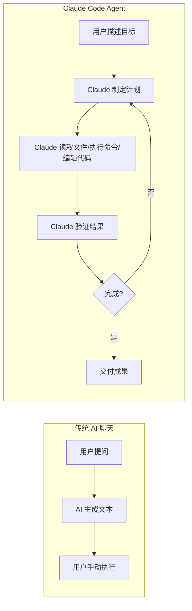

> **本文档基于 Claude Code v2.1.191 前后版本（2026 年 6 月）编写。** 部分功能标注了引入版本，使用旧版时可能不可用。运行 `claude update` 获取最新版。

# 概述与版本演进

## Claude Code 是什么

Claude Code 是 Anthropic 推出的 **Agentic 编码工具**——一个运行在终端中的 AI 代理。它能够阅读代码库、编辑文件、执行命令，并与你的开发工具集成。你可以通过自然语言让它构建功能、修复 Bug、自动化开发任务。

不同于普通的 AI 聊天工具，Claude Code 是一个 **代理（Agent）**：它不仅仅是回答你的问题，而是真正地在你的机器上执行操作——打开文件、运行命令、浏览网页、创建内容。

官方定义（[code.claude.com/docs/en/overview](https://code.claude.com/docs/en/overview)）：

> Claude Code is an agentic coding tool that reads your codebase, edits files, runs commands, and integrates with your development tools. Available in your terminal, IDE, desktop app, and browser.

### 全平台覆盖

Claude Code 作为一套统一的引擎，在不同平台上都提供一致的能力——你的 CLAUDE.md、settings.json、MCP 配置可以在所有平台上通用：

| 平台 | 定位 | 获取方式 |
|------|------|----------|
| **终端 CLI** | 功能最全的主力界面 | `curl -fsSL https://claude.ai/install.sh \| bash` |
| **VS Code 扩展** | IDE 内嵌 inline diff、@-mentions | VS Code 扩展市场搜索 "Claude Code" |
| **JetBrains 插件** | IntelliJ / PyCharm / WebStorm 集成 | JetBrains Marketplace |
| **Desktop App** | 可视化 diff、并排会话、定时任务 | macOS/Windows 下载独立应用 |
| **Web** | 浏览器内运行、无需本地环境 | [claude.ai/code](https://claude.ai/code) |
| **Slack** | 频道中 `@Claude` 触发 **claude.ai/code 云端会话** | Slack 集成 |

> **本书聚焦终端 CLI 版本**，它是功能最全面的界面。

### Claude Code 不是聊天工具

传统的 AI 聊天（ChatGPT、Claude.ai 对话等）是你问、AI 答。Claude Code 的本质区别在于**它能直接操作你的计算机**：



核心差异：Claude Code 自动完成"思考 → 行动 → 验证 → 修正"的闭环，你只需要描述目标即可。

## 与其他 AI 编码工具的区别

### 对比一览

| 特性 | Claude Code | Cursor | GitHub Copilot CLI | Codex CLI | Gemini CLI |
|------|-------------|--------|-------------------|-----------|------------|
| 运行位置 | 终端原生 | IDE（VS Code fork） | 终端 / IDE | 终端 / macOS App | 终端 |
| Agent 能力 | 多 Agent 团队 + Dynamic Workflows | Subagents + 并行 Plans（2026.01） | 内置 Agent + Autopilot + Cloud Agent | Multi-Agent + Goal Mode | Subagent + Auto Mode |
| Plan Mode | 内置 | 内置 | 内置（Shift+Tab） | 内置 | 内置 |
| 并行代理 | Agent Teams / Subagents / Batch Worktrees | 多 Agent 并行 worktrees（最多 8 个）| 内置并行 Agents + Cloud 后台 | Git Worktrees + 多 Agent | Subagent 协议 |
| 自定义扩展 | Skills + Hooks + MCP + Plugins | Skills + Hooks + MCP + Rules | Skills + MCP + Custom Agents | Skills + Hooks + MCP + Plugins | Skills + MCP + Custom Commands |
| 上下文窗口 | 1M（Opus 4.6+） | 取决于所选模型 | 1M+ | 取决于所选模型 | 1M（Gemini） |
| 模型选择 | Anthropic 全系列 + 第三方 | 多厂商模型 | GPT / Claude / Gemini | GPT 系列 | Gemini 系列 |

> **说明**：以上对比基于各工具截至 2026 年 6 月的公开信息。Cursor 的 Subagents 于 2026 年 1 月（v2.4）引入，并行 Plans 于 5 月（v3.3）引入。GitHub Copilot CLI 于 2026 年 2 月 GA，内置并行 Agents 和 Cloud 后台委派。Codex 的 Multi-Agent + Git Worktrees 于 2026 年 2 月随 Codex App 发布。Gemini CLI 的 Subagent 协议于 v0.44.0（2026 年 5 月）引入。

### 特别能力

**编排深度**：Claude Code 的 Agent Teams 支持 Peer-to-Peer 直接通信（Teammate 之间无需经过 Lead），Dynamic Workflows 让 Claude 自主编写 JavaScript 编排脚本动态生成 Harness。多数工具的并行是"一个主控分配任务给多个 Worker"，Claude Code 能做"多个 Agent 自己协商"。

**Hooks 系统**：Claude Code 当前有 14+ 种 Hook 事件类型（PreToolUse、PostToolUse、Stop、SubagentStop、PreCompact、SessionStart、SessionEnd、Notification、UserPromptSubmit 等），支持 Bash 命令和 Prompt（LLM 评估）两种执行方式，以及 `if` 条件过滤。这是同类工具中事件覆盖最广的 Hook 系统。

**沙箱安全**：Claude Code 的沙箱使用操作系统级原语（macOS Seatbelt / Linux bubblewrap），不是进程级隔离。沙箱运行时已开源（`@anthropic-ai/sandbox-runtime`），可作为独立组件复用。

**Auto Mode 的分类器**：Auto Mode 用一个独立的 Sonnet 模型审核每个操作。关键设计是分类器永远看不到工具执行结果——即使代码仓库或网页中有注入的攻击指令，也无法影响分类器的判断。这不是基于规则的检查，而是独立的 AI 审核。

**MCP 标准的创建者**：Model Context Protocol 由 Anthropic 制定，已成为跨工具的开放标准。其他工具是这一标准的采用者，Claude Code 作为标准的原生实现通常拥有最完整的 MCP 支持。

**Effort + Adaptive Thinking**：Claude Code 的 Effort 等级（low/medium/high/xhigh/max）与 Adaptive Thinking 是 Anthropic 模型独有的能力，让 Claude 自行决定每个推理步骤是否需要深入思考以及思考多深。

## 版本演进

### v0.2 beta 时期（2025 年初）
- 最早作为 Anthropic 内部工具，由 Boris Cherny 构建
- 基础的代码理解和编辑能力
- 内部团队验证后决定公开发布

### v1.0 GA（2025 年中）
- 正式公开发布（General Availability）
- npm 包 `@anthropic-ai/claude-code` 发布
- GitHub 仓库开源
- 基础的终端交互、文件编辑、Git 集成

### v2.0 系列（2025 年 11 月 - 2026 年 1 月）

| 版本 | 关键更新 |
|------|----------|
| v2.0 | Claude Opus 4.5 支持、Claude in Chrome、Background Agents |
| v2.1 系列开始 | 大量功能迭代，保持快速发布节奏 |

### v2.1 系列关键里程碑（2026 年 1 月 - 至今）

| 日期 | 版本 | 关键功能 |
|------|------|----------|
| 2026.01.08 | v2.1.1 | Skills 热加载、`/plan` 命令、Ctrl+B 后台化 Bash/subagent、图片粘贴、多终端兼容 |
| 2026.02.05 | v2.1.32 | **Agent Teams** 研究预览、Claude Opus 4.6 正式发布 |
| 2026.03.27 | v2.1.85 | Hooks `if` 条件触发、MCP OAuth RFC 9728、Plugin 市场安全加固 |
| 2026.04.16 | - | **Claude Opus 4.7 发布**，新 Tokenizer、xhigh Effort 级别、Adaptive Thinking 增强 |
| 2026.05.01 | v2.1.126 | Gateway Model Picker、`claude project purge`、OAuth 粘贴登录、PowerShell 升为 Windows 主 Shell |
| 2026.05.18 | v2.1.158 | Agent View（研究预览）、`claude agents` 命令 |
| 2026.06.02 | - | **Dynamic Workflows 官方博客发布**，Claude 自主编写 JS 编排脚本 |
| 2026.06.09 | - | Claude Fable 5 / Mythos 5 发布（API 端） |
| 2026.06.17 | v2.1.181 | `/config key=value` 语法、Bun 1.4 升级、Sandbox Apple Events、MCP OAuth 视觉升级 |
| 2026.06.22+ | v2.1.186+ | `claude mcp login/logout`、Opus 4.8、Fable 5 模型别名 |

### 模型线路图

```
2025年 ───── 2026年 ──────────────────────────────────>
  Opus 4.5    Opus 4.6 (2月)    Opus 4.7 (4月)    Opus 4.8 / Fable 5 (6月)
  Sonnet 4.5  Sonnet 4.6 (2月)                    Mythos 5 (6月, 安全)
  Haiku 4.5   Haiku 4.5 持续
```

## 社区影响

根据社区统计和公开访谈（非 Anthropic 官方数据）：

- Boris Cherny（Claude Code 创建者）月均 200-300 个 PRs，所有代码由 Claude 编写
- incident.io 团队 4 个月从零扩展到 4-7 并发 Claude 会话
- 社区累计 4200+ Skills、770+ MCP Servers、2500+ Marketplaces

## 本书内容导航

| 部分 | 章节 | 内容 |
|------|------|------|
| 总览 | 第 1 章 | 定位、版本演进 |
| 安装与配置 | 第 2-5 章 | 安装、settings.json、模型/Effort、权限/沙箱 |
| 上下文与记忆 | 第 6-7 章 | CLAUDE.md、Memory 系统 |
| 核心功能 | 第 8-11 章 | Plan Mode、文件编辑、终端命令、Git |
| 扩展体系 | 第 12-16 章 | Slash Commands、Skills、Hooks、MCP、Plugins |
| 并行与编排 | 第 17-21 章 | Worktrees、Subagents、Agent Teams、Dynamic Workflows、定时任务 |
| 平台集成 | 第 22-23 章 | IDE、Mobile、Remote Control、Dispatch |
| 企业与进阶 | 第 24、28 章 | 企业功能、Agent SDK |
| 实战 | 第 25-27 章 | 高手工作流、场景速查、故障排查 |
| 附录 | 附录 A-D | 命令速查、环境变量、衍生工具、社区资源 |

> **资料来源**：本章信息来自 [Claude Code 官方文档](https://code.claude.com/docs/en/overview)、[GitHub 仓库](https://github.com/anthropics/claude-code)、[Anthropic 官方博客](https://claude.com/blog) 及 [社区统计](https://claudemarketplaces.com/)。
