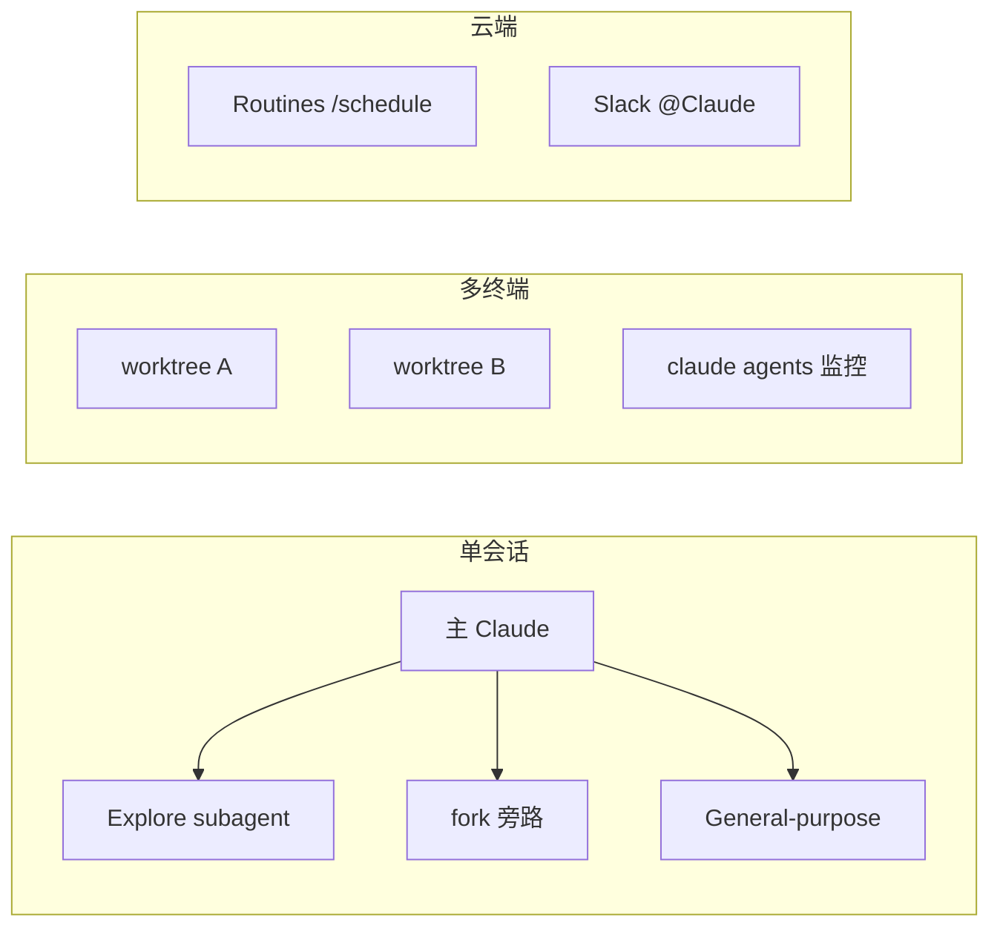

# 高手工作流

本章汇总 Anthropic 官方、Claude Code 创建者 Boris Cherny 及 production 团队公开的重度使用模式。原则可迁移到任何规模代码库。

## 核心原则（官方 Best Practices）

### 1. Verification First（验证优先）

给 Claude **可自检**的方式——比更长 prompt 更有效：

- 每次改动后跑测试 / lint
- 前端用 Chrome 扩展或 Desktop 目视验证
- `/simplify` 并行 3 个 review subagent
- **Writer + Reviewer** 双 Claude：一个写、一个审

### 2. Explore → Plan → Code

| 阶段 | 模式 | 目标 |
|------|------|------|
| Explore | subagent / Plan | 理解代码库，结论回主 context |
| Plan | `plan` / `/plan` | 方案落盘，人审后再动刀 |
| Code | `acceptEdits` / `auto` | 按 plan 一次性实施 |

走偏时**切回 Plan**，不在错误方向上 patch。

### 3. 上下文工程

- **第一条 prompt 写全**：意图、约束、验收、路径、反模式
- **减少往返轮次**——每轮用户消息都有固定开销
- **大文件用 subagent 或分段 Read**，避免一次塞满 context
- **CLAUDE.md 只放「每次都要遵守」的**——流程放 Skill，目录放 path-scoped rules

### 4. 工具链速度 = AI 倍率

incident.io 经验：90s 反馈循环会把 Claude 的秒级产出拖垮。先投资 **Biome/tsgo/Bun** 等，再堆并行 Agent。

---

## Boris Cherny（Claude Code 创建者）

**公开模式（社区访谈 / The Neuron 等，非官方 KPI）：**

| 实践 | 说明 |
|------|------|
| **5+ 并行 worktree** | Plan / 实施 / Review / 分析 分 Tab |
| **月均 200–300 PR** | Claude 写代码，人做架构与方向 |
| **Opus + thinking** | 「目前最好的 coding model」 |
| **Plan Mode 安全网** | 未批准前不改源码 |
| **颜色分 Tab** | `/color` 或终端配色区分会话 |

> 「一旦计划足够好，代码自然就对了。」

---

## incident.io（~50 万行 TypeScript）

4 个月从 0 扩到 **4–7 并发 Claude 会话**（第三方案例，[starmorph 整理](https://blog.starmorph.com/blog/claude-code-production-case-studies)）：

| 指标 | Before | After |
|------|--------|-------|
| JS 编辑器 UI | ~2h | ~10min |
| Build 优化 | 人工 | ~$8 API |
| lint+compile 循环 | 90s+ | <10s |
| Biome lint | 40s | <1s |

**洞察：**

1. **先快工具链，再上 AI**
2. **Voice-driven**：SuperWhisper 口述 5 分钟需求 → Claude 实现
3. 自研 **`w` CLI**：`w myproject new-feature claude` 一行创建 worktree + 启动 Claude

---

## Anthropic 研究 / HPC 案例

Clax、C 编译器等长期自主任务（[Research Blog](https://www.anthropic.com/research/long-running-Claude)）：

- **CLAUDE.md 活文档**——Claude 执行中自己更新，供 2000+ 会话接力
- Progress 文件 + Test Oracle 作 ground truth
- 单 Agent 顺序为主，按需 spawn Subagent

> 转向「自主 Agent 团队」前，应花大部分时间（与 Claude 一起）写清**交付物与上下文**的指令集。

---

## 编排模式速查

| 模式 | 何时用 |
|------|--------|
| Subagent | 单会话内调研/审查，省主 context |
| Fork / `/fork` | 继承对话的旁路，不污染历史 |
| Worktree × N | 并行改不同模块 |
| `/batch` | 5–30 单元迁移，每单元 worktree+PR |
| Agent Teams | 多实例 P2P 协作（实验性） |
| Routines | 定时/事件驱动，机器可关 |
| `claude -p \|` | CI、pre-commit、批处理 |

---

## 团队落地路径

1. **个人**：CLAUDE.md + 1 个 code-reviewer subagent
2. **小组**：共享 `.claude/rules/` + 内部 Plugin（lint hook、PR template skill）
3. **扩展并行**：worktree 规范 + `claude agents` 巡检
4. **企业**：Managed settings、MCP 白名单、OTel（第 24 章）

---

## 反模式

| 反模式 | 为何有害 |
|--------|----------|
| 无测试让 Claude 「觉得完成了」 | 幻觉式完成 |
| 单会话 8 小时不 compact | context _thrashing、质量下降 |
| 两 worktree 改同一文件 | merge 地狱 |
| 巨型 CLAUDE.md 500+ 行 | adherence 下降；用 rules 按需加载 |
| 跳过 Plan 直接 auto 上大重构 | 方向错误成本高 |

> **资料来源**：[Best practices](https://code.claude.com/docs/en/best-practices)、[Common workflows](https://code.claude.com/docs/en/common-workflows)、Boris/incident.io/Anthropic Research 公开材料
