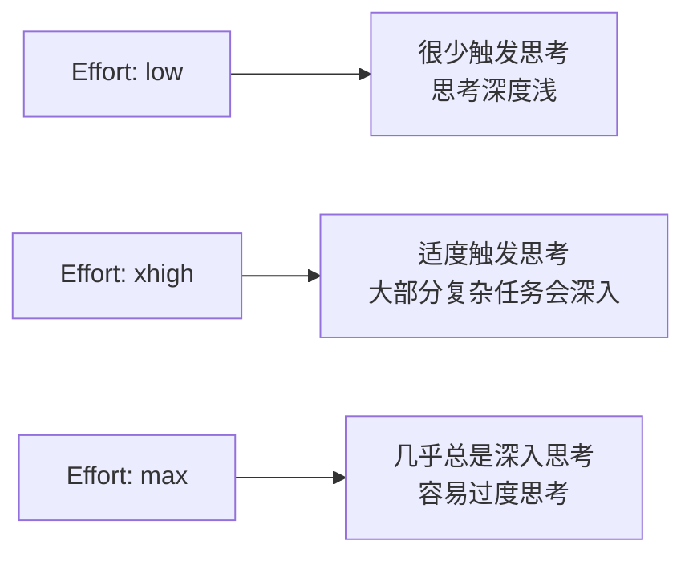

# 模型、Effort 与 Adaptive Thinking

## 可用模型与别名

Claude Code 使用**模型别名（Model Alias）**来屏蔽版本细节，让用户无需记忆精确的模型版本号。

| 别名 | 行为 |
|------|------|
| `default` | 特殊值，清除所有模型覆盖，恢复为账号类型的推荐模型 |
| `best` | 有组织访问权限时用 **Fable 5**，否则最新 Opus |
| `fable` | **Claude Fable 5**——最长自主任务、复杂推理（v2.1.170+，非默认模型） |
| `sonnet` | 最新的 Sonnet 模型，适合日常编码任务 |
| `opus` | 最新的 Opus 模型（Anthropic API 上当前为 **Opus 4.8**），适合复杂推理 |
| `haiku` | 快速高效的 Haiku 模型，适合简单任务 |
| `sonnet[1m]` | Sonnet + 1M token 上下文窗口 |
| `opus[1m]` | Opus + 1M token 上下文窗口 |
| `opusplan` | 规划阶段用 `opus`，执行阶段自动切换 `sonnet` |

### 别名对应的实际模型（截至 2026.06）

| API 端 | `opus` 解析为 | `sonnet` 解析为 |
|--------|--------------|----------------|
| Anthropic API / Claude Platform on AWS | **Opus 4.8** | **Sonnet 4.6** |
| Amazon Bedrock / Vertex / Foundry | Opus 4.6–4.7（可设环境变量覆盖） | Sonnet 4.5–4.6 |

> 别名会随时间更新指向推荐版本。如需锁定特定版本，使用完整模型名（如 `claude-opus-4-7`）或设置对应环境变量。

### 按账号类型的默认模型

| 账号类型 | 默认模型 |
|----------|----------|
| Max、Team Premium | Opus 4.8 |
| Pro、Team Standard、Enterprise、API | Sonnet 4.6 |
| Bedrock、Vertex、Foundry | Sonnet 4.5 |

## 设置模型的方式

有以下几种方式（优先级从高到低）：

**1. 会话中切换**（最高优先级）

```
/model              # 打开交互式选择器
/model opus         # 直接切换到 Opus
/model sonnet[1m]   # 切换为 Sonnet 1M 上下文
```

切换后保存到用户设置，重启后仍然生效。

**2. 启动时指定**

```shell
claude --model opus
claude --model claude-opus-4-7
```

此标志只影响当前会话，不会保存。

**3. 环境变量**

```shell
export ANTHROPIC_MODEL=opus
```

**4. settings.json 配置**

```json
{ "model": "opus" }
```

### opusplan 模式

`opusplan` 是一个特殊的混合模式：

- **Plan Mode 阶段**：使用 Opus 进行复杂推理和架构决策
- **执行阶段**：自动切换为 Sonnet 进行代码生成

这样在规划时获得最强推理能力，执行时获得效率。

### 模型选择限制（企业管理员）

管理员可通过 `availableModels` 限制用户可选模型：

```json
{ "availableModels": ["sonnet", "haiku"] }
```

注意：`Default` 选项始终可用，不受 `availableModels` 限制。

## Effort 等级

Effort（努力等级）控制模型在每次推理中投入多少"思考"。Effort 越低，速度越快、成本越低；Effort 越高，推理越深入。

### 支持的模型与等级

| 模型 | 可用等级 |
|------|----------|
| **Opus 4.7** | `low`、`medium`、`high`、`xhigh`、`max` |
| Opus 4.6 / Sonnet 4.6 | `low`、`medium`、`high`、`max` |

如果设置了当前模型不支持的等级，会退回到该模型支持的不超过目标值的最高等级。例如在 Opus 4.6 上设置 `xhigh`，会退回 `high`。

### 默认等级（截至 v2.1.117）

| 模型 | 默认 Effort |
|------|-------------|
| Opus 4.7 | `xhigh` |
| Opus 4.6 / Sonnet 4.6 | `high` |

### 各等级适用场景

| 等级 | 适用场景 |
|------|----------|
| `low` | 短小、明确、不需深度思考的任务，对延迟敏感 |
| `medium` | 成本敏感、允许牺牲部分智能的任务 |
| `high` | 平衡智能和成本。对智能敏感的任务最低应选此等级 |
| `xhigh` | **大多数编码和 Agentic 任务的推荐等级**。Opus 4.7 下默认值 |
| `max` | 极端复杂的任务，可能收益递减、容易过度思考。**仅当前会话有效**（除非通过环境变量设置） |

### 设置 Effort 的方式

```
/effort              # 打开交互式滑块
/effort xhigh        # 直接设置
/effort auto         # 重置为模型默认值
```

启动时：

```shell
claude --effort xhigh
```

环境变量：

```shell
export CLAUDE_CODE_EFFORT_LEVEL=xhigh
```

settings.json（不支持 `max`）：

```json
{ "effortLevel": "xhigh" }
```

Skill 和 Subagent 的 frontmatter 中也可设置 `effort` 字段，覆盖该 Skill/Subagent 运行时的 Effort。

### ultrathink 关键字

在 prompt 中任意位置插入 `ultrathink` 关键字，可以请求当次回复使用更深度的推理，而不改变会话的 Effort 设置。只有 `ultrathink` 被识别为关键字，"think"、"think hard" 等不会被特殊处理。

## Extended Thinking（扩展思考）

Extended Thinking 是 Claude 在回复前生成的推理过程（思维链）。

**控制方式：**

| 操作 | 方法 |
|------|------|
| 当前会话切换 | macOS: `Option+T`；Windows/Linux: `Alt+T` |
| 全局默认设置 | 运行 `/config` 切换思考模式，保存为 `alwaysThinkingEnabled` |
| 彻底禁用思考 | 设置 `MAX_THINKING_TOKENS=0` |

思考输出**默认折叠**显示。按 `Ctrl+O` 切换详细模式查看灰色斜体的推理过程。被折叠的思考 token 同样会计费。

## Adaptive Thinking（自适应思考）

Adaptive Thinking 让模型在每个推理步骤自行决定是否需要思考以及思考多少——面对简单问题快速回复，面对复杂问题深入推理。

- **Opus 4.7**：始终使用 Adaptive Thinking，无法禁用
- **Opus 4.6 / Sonnet 4.6**：可通过设置 `CLAUDE_CODE_DISABLE_ADAPTIVE_THINKING=1` 回到传统的固定思考预算模式（由 `MAX_THINKING_TOKENS` 控制）

### Effort 与 Adaptive Thinking 的关系

Effort 等级本质上是调节 Adaptive Thinking 的"触发阈值"和"思考深度上限"：



Anthropic 的官方建议是：**交给 Effort 等级来控制思考行为**，而不是试图在 prompt 中手工指导。如果发现模型思考不足，优先提高 Effort 等级而非改 prompt。

## 1M Token 上下文窗口

Opus 4.7、Opus 4.6、Sonnet 4.6 均支持 1M token 上下文窗口。

### 可用性

| 计划 | Opus 1M | Sonnet 1M |
|------|---------|-----------|
| Max、Team、Enterprise | 订阅包含 | 需 Extra Usage |
| Pro | 需 Extra Usage | 需 Extra Usage |
| API / Pay-as-you-go | 完全可用 | 完全可用 |

1M 上下文使用标准定价，200K 以上不另行加价。

- Opus 在 Max/Team/Enterprise 计划中**自动升级为 1M 上下文**，无需额外配置
- 如需禁用 1M 上下文：设置 `CLAUDE_CODE_DISABLE_1M_CONTEXT=1`

## Fast Mode

Fast Mode 是 Opus 4.6 的一项研究预览特性，提供**显著更快**的输出 token 生成速度。通过 `/model` 选择器中的 Fast 选项启用。适用于延迟敏感、对 Token 成本不太在意的场景。

## Gateway Model Picker

当 `ANTHROPIC_BASE_URL` 指向一个兼容 Anthropic Messages API 的 Gateway 时，`/model` 选择器会自动从 Gateway 的 `/v1/models` 端点拉取可用模型列表。这使得使用第三方代理或自建 Gateway 时无需手动配置模型名。

> **资料来源**：[Claude Code 官方文档 - Model Configuration](https://code.claude.com/docs/en/model-config)、[Effort](https://platform.claude.com/docs/en/build-with-claude/effort)、[Opus 4.7 Best Practices](https://claude.com/blog/best-practices-for-using-claude-opus-4-7-with-claude-code)
