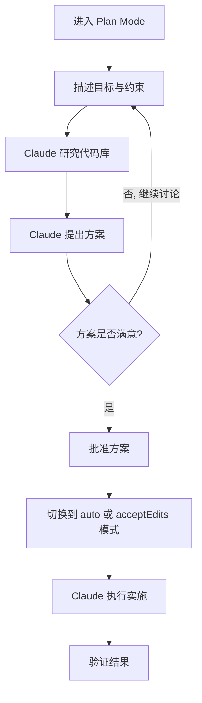

# Plan Mode

## 什么是 Plan Mode

Plan Mode（计划模式）是 Claude Code 的一个权限模式，告诉 Claude **只做研究和提议，不要修改代码**。Claude 可以阅读文件、执行探索性的 Shell 命令、提出疑问、编写计划文件，但不会编辑你的源代码。

这是一个读/分析模式——权限提示的行为和 default 模式一样（Bash 命令、网络请求等仍然需要确认），但文件编辑被阻止。

## 核心理念

来自 Boris Cherny（Claude Code 创建者）和 Anthropic 内部团队反复验证的原则：

> **"一旦计划足够好，代码自然就对了。"**

花费足够的精力在 Plan Mode 中完善方案，然后切换到执行模式让 Claude 一次性完成实施，这比边写边改要高效得多。

## 进入 Plan Mode

### 会话中切换

按 `Shift+Tab` 进入 Plan Mode（在 `default` → `acceptEdits` → `plan` 循环中）。

### 单条 prompt 中

```
/plan 请帮我重构认证模块，改用 OAuth2.0
```

### 启动时直接进入

```shell
claude --permission-mode plan
```

## 典型工作流



## 高级模式

### 多 Claude 协作审查

来自 Anthropic 内部团队的一个实用模式：

1. 让一个 Claude 写 Plan
2. 用第二个 Claude（作为 Staff Engineer 角色）审查这个 Plan
3. 修改完善后进入实施

### Plan 出问题时重新规划

在实施过程中如果事情走偏，不要尝试在途中纠正——切回 Plan Mode 重新制定方案：

1. 按 `Shift+Tab` 回到 Plan Mode
2. `/plan 我们的实施方案在XX方面有问题，重新制定这一部分的方案`
3. 在新的 Plan 确认后继续执行

### Plan Mode + 自动命名

进入 Plan Mode 后，Claude 会根据你正在处理的内容自动给你的会话命名。你也可以在启动时手动指定：

```shell
claude --name "auth-refactor"
```

## Plan 完成后的选择

当 Plan 完成后，Claude 会呈现方案并询问如何继续。你可以选择：

- **批准并以 Auto Mode 开始**（信任 Claude 自主执行）
- **批准并接受编辑**（手动审查每次编辑）
- **继续规划**（反馈更多意见给 Claude）

每种批准选项还提供"在开始执行前清除规划上下文"的选择，以释放 Token 空间。

## 与 opusplan 模型的配合

`opusplan` 模型别名是 Plan Mode 的最佳搭档（详见第 4 章）：

- **Plan Mode 阶段**自动使用 Opus（最强推理）
- **执行阶段**自动切换 Sonnet（高效率）

```shell
claude --model opusplan --permission-mode plan
```

## 最佳实践

1. **任务描述要在第一轮给足**：好的任务描述应包含意图、约束、验收标准、相关文件位置。

2. **减少用户交互轮次**：每轮用户交互增加推理开销。把问题批量化，给模型足够的上下文让它持续推进。

3. **Plan 文件可复用**：让 Claude 将 Plan 写入文件而非只在对话中展示——作为后续实施、Code Review 的参考依据。

> **资料来源**：[Claude Code 官方文档 - Permission Modes](https://code.claude.com/docs/en/permission-modes)、[Power User Tips](https://support.claude.com/en/articles/14554000-claude-code-power-user-tips)、[Opus 4.7 Best Practices](https://claude.com/blog/best-practices-for-using-claude-opus-4-7-with-claude-code)
