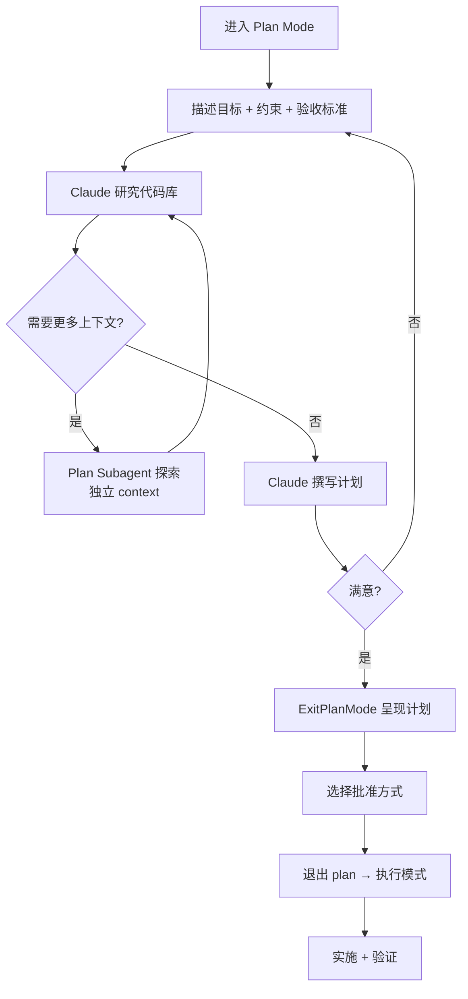

# Plan Mode

Plan Mode（`plan` 权限模式）让 Claude **先研究、再提议、后动手**——可读文件、跑探索性 Bash、写计划文件，但**不编辑你的源代码**。

## 与其他模式的区别

| 模式 | 读文件 | 探索性 Bash | 编辑源码 | 典型用途 |
|------|--------|-------------|----------|----------|
| `default` | ✓ | 需确认 | 需确认 | 日常交互 |
| `acceptEdits` | ✓ | 需确认 | 自动批准（受保护路径除外） | 迭代开发 |
| **`plan`** | ✓ | 需确认（同 default） | **阻止** | 架构设计、重构方案 |
| `auto` | 分类器审核 | 分类器审核 | 分类器审核 | 长任务少打断 |

Plan Mode **不是**「所有操作免确认」——Bash、网络等仍按 default 规则弹窗；只是 **Write/Edit 被阻止**。

## 进入 Plan Mode

| 方式 | 命令/操作 |
|------|-----------|
| 会话中循环 | `Shift+Tab` 切到 `plan` |
| 单条 prompt | `/plan 重构认证模块` |
| 启动时 | `claude --permission-mode plan` |
| 工具驱动 | Claude 调用 `EnterPlanMode` 工具 |
| 项目默认 | `.claude/settings.json` 设 `"defaultMode": "plan"` |

再次 `Shift+Tab` 可**离开 plan 模式**而不批准计划。

## 标准工作流



### Plan Subagent

Plan Mode 下 Claude 需要理解代码库时，会委派内置 **Plan** subagent——探索结果在**独立 context**，主会话保持只读。Explore/Plan subagent **不加载** CLAUDE.md 与 git status（为省 token、提速）。

### 计划批准（`ExitPlanMode`）

计划完成后 Claude 调用 `ExitPlanMode`，你可选择：

- **批准并以 Auto Mode 开始**——信任分类器，少弹窗
- **批准并接受编辑**——每次编辑仍确认
- **继续规划**——反馈后修订
- **可选：清除规划上下文**——释放 token，只保留计划摘要

批准后**自动退出 plan 模式**并切换到所选执行模式。要再规划：`Shift+Tab` 或 `/plan`。

### 在外部编辑器中改计划

VS Code 扩展中 Plan 会以完整 Markdown 文档打开，可**行内批注**后再让 Claude 执行。

## 与 `opusplan` 的配合

```shell
claude --model opusplan --permission-mode plan
```

- **Plan 阶段**：Opus（强推理）
- **执行阶段**：自动切 Sonnet（高效率）

订阅 tier 自动升级 1M 时，plan 阶段同样受益。可用 `opusplan[1m]` 强制 1M。若 `availableModels` 排除 Opus，plan 阶段也会留在 Sonnet。

## `useAutoModeDuringPlan`

默认 `true`：在组织启用 Auto Mode 时，**Plan Mode 内的 Bash/探索**可走 auto 分类器语义，减少探索阶段的确认。可在 `/config` 关闭「Use auto mode during plan」。

## 高级模式

### 多 Claude 审查 Plan

1. Claude A 在 Plan Mode 写方案
2. Claude B（Staff Engineer 角色 / code-reviewer subagent）审查
3. 修订后批准执行

### 执行走偏 → 重新规划

不要在错误方向上硬改：

1. `Shift+Tab` 回到 plan
2. `/plan XX 部分方案有问题，请重新规划该模块`
3. 确认新 plan 后继续

### 会话命名

```shell
claude --name "auth-refactor" --permission-mode plan
```

Plan Mode 下 Claude 也会根据任务**自动命名**会话，便于 `/resume` 查找。

### Ultraplan（Web）

在 [claude.ai/code](https://claude.ai/code) 跑 Plan Mode，浏览器内审阅计划——适合大改前先远程讨论。

## 最佳实践

1. **第一条 prompt 给足**：意图、约束、验收标准、相关路径、禁止事项
2. **计划落盘**：让 Claude 把 plan 写入文件（如 `docs/plans/auth-refactor.md`），供实施与 Review 引用
3. **大探索用 subagent**：「用 subagent 调查 token refresh 流程」——主 context 只收结论
4. **验证闭环**：Plan 里写清「如何验证完成」（测试命令、手动步骤）
5. **敏感目录用 path-scoped rules**：`.claude/rules/` 对 `src/billing/**` 强制 plan（见第 6 章）

## 核心理念

> **「一旦计划足够好，代码自然就对了。」** — Boris Cherny

Plan Mode 是**安全网**：放心让 Claude 自主调研，未批准前磁盘上的源码不会被改。

> **资料来源**：[Permission modes - Plan mode](https://code.claude.com/docs/en/permissions#analyze-before-you-edit-with-plan-mode)、[Common workflows](https://code.claude.com/docs/en/common-workflows)、[Subagents - Plan](https://code.claude.com/docs/en/sub-agents)
