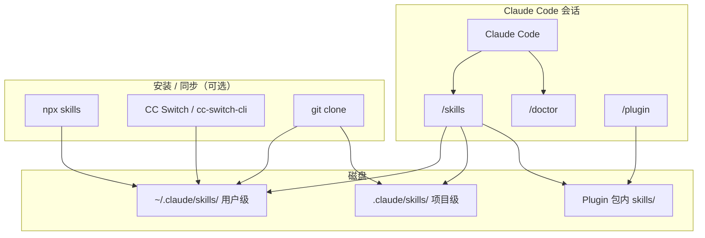

# 管理架构与快速上手

Claude Code 的 Skill 以 `SKILL.md` 目录形式存放在本地；安装、同步、会话内开关由不同工具分担。本章说明分工边界、安装入口，以及安装后的验证命令。

---

## 管理架构



| 层级 | 职责 | 工具 / 路径 |
|------|------|-------------|
| 运行时 | Skill 加载、Enable/Disable、描述预算、Plugin 生命周期 | Claude Code：`/skills`、`/doctor`、`/plugin`、`/reload-plugins` |
| 磁盘 | Skill 文件存放 | `~/.claude/skills/`、`.claude/skills/`、Plugin 安装目录下的 `skills/` |
| 安装 / 同步 | 下载、写入磁盘、多 Agent 分发 | `npx skills`、CC Switch、git clone、Claude Code `/plugin` |

会话内是否加载某个 Skill，由 Claude Code 读取磁盘路径并结合 `/skills` 状态决定。CC Switch 负责安装与同步层，不替代 Claude Code 运行时。

**同名覆盖**：Enterprise > Personal > Project。Plugin 内 Skill 以 `plugin-name:skill-name` 命名，与单体 Skill 一般不冲突。

---

## CC Switch 与 Claude Code 的分工

CC Switch 可管理大部分单体 Skill 文件的安装与 sync；Plugin 市场包与 Claude Code bundled Skill 不在其管理范围内。

| 能力 | Claude Code | CC Switch |
|------|:-----------:|:---------:|
| 安装 Plugin（hooks / MCP / 多 Skill 打包） | `/plugin` | 不支持 |
| 安装单体 Skill（GitHub、skills.sh） | npx / git / 手写 | GUI 或 `cc-switch skills` |
| 写入 / 同步 `~/.claude/skills/` | 各安装工具各自写入 | `skills sync` |
| 切换 Provider 后 Skill 文件保留 | 本地文件不变 | 切换后执行 `skills sync` |
| 多 Agent（Claude Code + Cursor 等） | 仅 Claude Code 路径 | symlink / copy 到各 Agent |
| 会话内 Enable / Disable | `/skills` | enable / disable + sync |
| 描述预算、truncation、dropped | `/doctor` | 无 |
| bundled 内置 Skill | 随 Claude Code 提供 | 无 |

**Plugin 类仓库分两种安装路径：**

| 仓库 | Claude Code 推荐路径 | CC Switch / npx | 说明 |
|------|---------------------|-----------------|------|
| Superpowers | `/plugin install` | 不适用 | 官方 README 仅列出 Plugin；依赖 `session-start` Hook，只复制 `skills/` 目录无法完整生效 |
| skill-creator | `/plugin install skill-creator@claude-plugins-official` | 不适用 | 官方文档指定 Plugin；Cursor 可用内置 `/create-skill` |
| baoyu-skills | `/plugin` 或 `npx skills add` | 可以 | 上游 README 将 `npx skills add` 标为 Quick Install；Plugin 为整包分发 |

CC Switch 不能执行 `/plugin marketplace` / `/plugin install`，因此 **Superpowers、skill-creator 须进 Claude Code 装**；baoyu-skills 可走 CC Switch / npx 装单体 Skill 文件。

**单体 Skill**（如 grill-me、frontend-design）可通过 CC Switch、`npx skills add` 或 git clone 安装；CC Switch 路径在 `install` 后执行 `skills sync`。

**重复安装**：同一 Skill 不宜同时用 npx 与 CC Switch 各装一次；`/skills` 列表可能无重复项，但 description 会重复计入预算。

分工速查：

```
Plugin 套装（Superpowers、skill-creator）→ Claude Code /plugin
双通道（baoyu-skills）                  → npx / CC Switch，或 /plugin
单体 Skill                              → CC Switch install + sync（推荐）；或 npx（无 CC Switch）；勿混装
开/关、诊断                             → Claude Code /skills、/doctor
切换 Provider                           → cc-switch skills sync
```

CC Switch 产品：[farion1231/cc-switch](https://github.com/farion1231/cc-switch)（桌面 GUI）、[cc-switch-cli](https://github.com/SaladDay/cc-switch-cli)（CLI）；Skills 能力一致。

---

## 安装方式对照

| 安装对象 | 方式 | CC Switch |
|----------|------|-----------|
| Plugin 市场（Superpowers、skill-creator 等，含 hooks/MCP） | Claude Code `/plugin install` | 不支持 |
| 双通道仓库（baoyu-skills 等） | `/plugin` 或 `npx skills add` / CC Switch | 支持 npx 路径 |
| 单体 Skill、skills.sh | `npx skills add` 或 CC Switch | 支持 |
| 带 setup 脚本的仓库（如 gstack） | git clone + 运行 setup | clone 后可纳入 CC Switch；setup 须手动执行 |
| 团队 `.claude/skills/` 进 git | git | 可选 import / sync |
| 自建 | 编写 `SKILL.md` | 可放入 CC Switch 管理目录 |

CLI 参数与排错见 [05 安装方式参考手册](05-安装方式参考手册.md)。组合方案与编程工作流见 [03 选型与组合方案 · 本章导航](03-选型与组合方案.md#本章导航)。

---

## 快速上手

### 流程

1. 按「安装方式对照」确定安装工具
2. 执行安装命令
3. Claude Code 中运行 `/skills`、`/doctor`
4. 手动 `/skill-name`，并用自然语言测试自动触发

### CC Switch：单体 Skill 示例

- **推荐（CC Switch 用户）**：`repos add`（首次）→ `discover` 查目录名 → `install owner/repo:目录名` → `sync`。
- **备选（无 CC Switch）**：见下方「npx」小节；**不要混装**。
- **注意**：cc-switch **没有** `--skill`；勿照搬 npx 的 `--skill` 写法。

```bash
# 首次：把源仓库加入 SSOT（已添加可跳过）
cc-switch skills repos add mattpocock/skills

# 安装（SPEC = owner/repo:目录名）
cc-switch skills install mattpocock/skills:grill-me -a claude
cc-switch skills sync
```

Claude Code 会话：

```
/skills
/grill-me
/doctor
```

### Claude Code：Plugin 示例

- **推荐（官方 Market）**：Superpowers 等官方收录包。
- **备选（作者 Market）**：官方找不到包时 → [07 · 安装](07-工作流方法论-Superpowers.md#安装)。

CC Switch **不参与** Plugin 安装。

```
# 推荐 — 官方 Market
/plugin install superpowers@claude-plugins-official
/reload-plugins
/skills
```

```
# 备选 — 作者 Market（官方找不到包时）
/plugin marketplace add obra/superpowers-marketplace
/plugin install superpowers@superpowers-marketplace
/reload-plugins
/skills
```

Plugin 安装后若未出现在列表：执行 `/reload-plugins`；仍不可见则重启 Claude Code 会话。

### npx：无 CC Switch 时

- **推荐（终端 / 无 CC Switch）**：`npx skills add` 装单体服务 Skill。
- CC Switch 用户请用上节 CC Switch 路径，**不要与 npx 混装同一 Skill**。

```bash
npx skills add mattpocock/skills --skill grill-me -g -a claude-code -y
```

验证步骤同「安装后验证」。

### 安装后验证

| 检查项 | 命令 | 通过条件 |
|--------|------|----------|
| 列表与状态 | `/skills` | 目标 Skill 存在且为 Enabled |
| 描述预算 | `/doctor` | dropped = 0；非 0 时见 [13 治理](13-治理-调优与冲突.md) |
| 手动触发 | `/grill-me` | 响应符合 SKILL.md 指令 |
| 自动触发 | `我想做登录功能，先把需求问清楚` | 匹配 grill-me 对应行为 |

---

## 全书结构

章节按用途分类，非按仓库 Star 数排列。

| 类型 | 章节 | 内容 |
|------|------|------|
| 工具链 | [06 工具链](06-工具链-元Skill与安装器.md) | skill-creator、npx skills |
| 工作流方法论 | [07 Superpowers](07-工作流方法论-Superpowers.md)、[08 四套系统](08-工作流方法论-四套系统.md) | 开发流水线；Superpowers 独立成章；GSD / gstack / mattpocock / Karpathy 合于 08 |
| 领域 Skill | [09 前端](09-领域Skill-前端与UI.md)、[10 内容](10-领域Skill-内容创作.md) | 前端 UI、内容创作 |
| 生态索引 | [11 生态索引](11-生态索引.md) | 仓库目录 |
| 自建 | [12 自建](12-自建Skill-开发指南.md) | 编写 SKILL.md |

| 主题 | 章节 |
|------|------|
| 组合选型与安装 | [03 选型](03-选型与组合方案.md) |
| CC Switch CLI 命令 | [05 手册](05-安装方式参考手册.md) |
| 原理与描述预算 | [01 基础](01-基础与生态概览.md) |
| 数量控制与冲突 | [13 治理](13-治理-调优与冲突.md) |

---

> 资料来源：[Claude Code Skills](https://code.claude.com/docs/en/skills)、CC Switch / cc-switch-cli README
