# 选型与组合方案

> **装之前**：含 hooks/MCP 的 Plugin（Superpowers、skill-creator）须在 **Claude Code `/plugin`** 安装；单体 Skill 及 baoyu-skills 的 npx 路径可用 **CC Switch** 或 npx（见 [01 管理架构](01-管理架构与快速上手.md)）。  
> 还没装过任何一个 Skill？先读 [01 管理架构与快速上手](01-管理架构与快速上手.md)。

## 本章导航

> **组合在本章，深潜在各章**：下面五方案只写「怎么装 + 怎么在一次（或多次）会话里串起来」。Superpowers / GSD / gstack / mattpocock 的单 Skill 指令与架构 → [07 工作流·Superpowers](07-工作流方法论-Superpowers.md) · [08 工作流·四套系统](08-工作流方法论-四套系统.md)。frontend / baoyu 等领域包 → [09 前端与 UI](09-领域Skill-前端与UI.md) · [10 内容创作](10-领域Skill-内容创作.md)。**不走五方案、只装单个 Skill** → [09 § 9.6 单独使用](09-领域Skill-前端与UI.md#_9-6-standalone) · [10 § 10.6 单独使用](10-领域Skill-内容创作.md#_10-6-standalone)。

| 区块 | 安装 | 编程工作流 |
|------|------|------------|
| [通则](#编程会话通则五个方案共用) | — | 起手式、自动 vs 手动、多 Skill 共存 |
| [方案 A](#方案-a单人全栈) | [A 安装](#方案-a-安装) | [A 工作流](#方案-a-工作流) |
| [方案 B](#方案-b团队协作) | [B 安装](#方案-b-安装) | [B 工作流](#方案-b-工作流) |
| [方案 C](#方案-c快速原型-产品验证) | [C 安装](#方案-c-安装) | [C 工作流](#方案-c-工作流) |
| [方案 D](#方案-d最少组合) | [D 安装](#方案-d-安装) | [D 工作流](#方案-d-工作流) |
| [方案 E](#方案-e-token-敏感本地-llm-按量-api) | [E 安装](#方案-e-安装) | [E 工作流](#方案-e-工作流) |
| [社区参考](#社区大神怎么配参考不是必装) | — | — |
| [装完之后](#装完组合之后) | — | 链到 13 / 12 / 05 |

## 选型前先知道

- **不是装越多越好**：10–15 个活跃 Skill 是常见上限（含 bundled）。治理见 [13 治理](13-治理-调优与冲突.md)。
- **组合 = Plugin 套装 + 少量单体 Skill**，不要同一能力装两份（例如 Superpowers 里已有 TDD，不必再装独立 tdd Skill）。
- **CC Switch 用户**：下面命令装完后执行 `cc-switch skills sync`（或用 GUI Sync）。cc-switch 用 **`owner/repo:目录名`** 作 SPEC，**没有** npx 的 `--skill`；详见 [05 § 5.2](05-安装方式参考手册.md)。

---

## 编程会话通则（五个方案共用）

装完任一方案后，每次开写代码前走同一套起手式；下面各方案的 **「编程工作流」** 是在此基础上的组合差异。

### 会话起手

```
/skills          # 确认本方案组件均为 Enabled
/doctor          # dropped = 0；非 0 见 13 治理
```

[Claude Code 文档](https://code.claude.com/docs/en/skills)：Skill 通过 **listing 里的 description 自动匹配**，或你 **手动 `/skill-name`** 调用。User-invoked Skill（如 `/grill-me`）**不会**自动触发，须自己输入命令。

### 自动 vs 手动

| 类型 | 代表 | 你怎么用 |
|------|------|----------|
| **Model-invoked** | Superpowers 的 brainstorming、frontend-design、Karpathy（Plugin/CLAUDE.md） | 用自然语言描述任务；匹配 description 后 Agent 加载 SKILL.md |
| **User-invoked** | `/grill-me`、`/office-hours`、`/gsd:new-project` | **必须**输入 slash 命令（或上游文档写明的别名） |
| **行为约束（无独立 Skill 命令）** | Karpathy 四条原则 | 写入 CLAUDE.md 或 Plugin 后**每轮生效**，不单独 `/` |

### 多 Skill 同时装时

- **编排 Skill 优先**：如 Superpowers 的 brainstorming 会在写代码前拦住你；不要在同一任务上再手动 `/grill-me` 重复澄清（除非 Superpowers 未加载）。
- **领域 Skill 叠加**：做 UI 时 frontend-design / ui-ux-pro-max 与流程 Skill **可并存**——前者管审美/设计系统，后者管需求→计划→实现顺序（见各方案说明）。
- **冲突**：同一能力不要装两份（如 Superpowers 已有 TDD，不必再装 mattpocock `tdd`）。

---

## 方案 A：单人全栈（⭐⭐⭐⭐⭐）

**适合**：个人项目、想要完整「需求→计划→TDD→调试」流水线。

| 组件 | 作用 | Claude Code 怎么装 | CC Switch | 其他 Agent（Codex / Cursor…） |
|------|------|-------------------|-----------|-------------------------------|
| **Superpowers** | brainstorming / writing-plans / TDD… | **`/plugin`**（须 hooks，无 npx 路径） | **不能**代装 Plugin | **能**，但要在各 Agent **分别安装**（见 [07 § 安装](07-工作流方法论-Superpowers.md)） |
| **Karpathy 四原则** | 行为约束 | **`/plugin`** 或项目 **`CLAUDE.md`**（二选一） | **不能**代装 Plugin；`CLAUDE.md` 走 git / Prompts 同步 | **能**（如 Cursor 用 `.cursor/rules/karpathy-guidelines.mdc`） |
| **frontend-design** | UI 审美 | npx 或 CC Switch | **可以** | npx `-a codex` 等 |

**说明**

- 上表「Claude Code 怎么装」针对方案 A 在 **Claude Code 里**怎么配；**不等于** Superpowers / Karpathy 只能给 Claude 用。
- **Superpowers**：在 Claude Code 必须 `/plugin`（CC Switch 管不了 Plugin 市场）。你在 Codex 里要用，得在 Codex 里再装一遍（例如 `/plugins` 搜 superpowers），**不会**跟着 Claude Code 的安装自动过去。
- **Karpathy**：**不是**只能 `/plugin`。上游提供三种常见路径——Claude Code Plugin（全局）、单项目 `curl` 进 `CLAUDE.md`、Cursor 规则文件。CC Switch 的 **Skills 面板**装不了 Karpathy Plugin；若选 `CLAUDE.md` 方案，用 **git 提交** 或 CC Switch **Prompts** 同步记忆文件，而不是 `skills install`。
- **frontend-design** 才是本方案里适合 CC Switch `install` + `sync` 的那一项。

**Skill 预算**：约 17（接近上限，不要再堆）

<a id="方案-a-安装"></a>

### 安装（Claude Code 终端）

> Superpowers 备选 Market → [07 § 7.6](07-工作流方法论-Superpowers.md#76-安装)

**1. Superpowers**

- **推荐（官方 Market）**：Claude Code 默认路径，与 [07 § 7.6](07-工作流方法论-Superpowers.md#76-安装) 一致；作者 Market 仅官方找不到包时用。

```
/plugin install superpowers@claude-plugins-official
/reload-plugins
```

**2. Karpathy 四原则**

- **推荐 A（Plugin 全局）**：方案 A 会跨多个个人项目，四条编码原则适合 **User scope 装一次、处处生效**。
- **备选 B（单项目 `CLAUDE.md`）**：只想约束**当前仓库**，或要把规则 **提交进 git 给团队** 时用；**不要与 A 双装**（重复注入同一段约束）。

```
# A. Plugin 全局（推荐）
/plugin marketplace add forrestchang/andrej-karpathy-skills
/plugin install andrej-karpathy-skills@karpathy-skills
/reload-plugins
```

```bash
# B. 单项目 CLAUDE.md（备选）
curl -o CLAUDE.md https://raw.githubusercontent.com/forrestchang/andrej-karpathy-skills/main/CLAUDE.md
```

**3. frontend-design**

- **推荐（CC Switch 用户）**：本方案里 frontend-design 适合走 CC Switch 的 `install` + `sync`（与上文「CC Switch 用户」说明一致）。
- **备选（终端 / 无 CC Switch）**：直接 `npx skills add` 装到 Claude Code 全局。
- **不要两条都跑**（会装两份同名 Skill）。

```bash
# 推荐（CC Switch）
cc-switch skills install anthropics/skills:frontend-design && cc-switch skills sync
```

```bash
# 备选（npx）
npx skills add anthropics/skills --skill frontend-design -g -a claude-code -y
```

**收尾**

```
/skills
/doctor
```

<a id="方案-a-工作流"></a>

### 编程工作流

> 依据：[obra/superpowers](https://github.com/obra/superpowers) SKILL.md 与 [07 § 7.5](07-工作流方法论-Superpowers.md#75-完整工作流串联)；[forrestchang/andrej-karpathy-skills CLAUDE.md](https://github.com/forrestchang/andrej-karpathy-skills/blob/main/CLAUDE.md)；[anthropics/skills frontend-design SKILL.md](https://github.com/anthropics/skills/blob/main/skills/frontend-design/SKILL.md)。

#### 组件分工

| 组件 | 何时介入 | 触发方式 |
|------|----------|----------|
| **Superpowers** | 新功能 / 改行为 / 修 Bug 的**全流程编排** | Model-invoked（brainstorming 等对「创建功能、修改行为」类请求自动匹配，见 07 § 7.4.1） |
| **Karpathy 四原则** | **每一行代码**的假设、简洁、改动范围、可验证目标 | 常驻约束（Plugin 或 CLAUDE.md），无 slash |
| **frontend-design** | **做 UI / 改界面**时的审美与版式 | Model-invoked（description 匹配「building new UI」类任务）；也可在 prompt 里点名 |

#### 新功能（端到端）

Superpowers README / 07 § 7.5 描述的串联（hooks 正常时 **自动** 衔接，无需你记全命令名）：

```
你: 帮我做一个用户认证功能
    ↓
[brainstorming]  一次一个问题、优先选择题；2–3 种方案；设计分 200–300 字块确认
    ↓ 设计写入 docs/plans/YYYY-MM-DD-<topic>-design.md
[using-git-worktrees]  隔离 worktree、确认测试基线
    ↓
[writing-plans]  2–5 分钟粒度任务，含代码与验证步骤 → docs/plans/...-plan.md
    ↓ 你确认后说 "go"
[subagent-driven-development]  按任务派发子 Agent + 两阶段审查
    ↓
[finishing-a-development-branch]  测试通过 → merge / PR / 保留 / 丢弃
```

**Karpathy 在整个过程中**：Think Before Coding（不确定先问）、Simplicity First、Surgical Changes、Goal-Driven Execution（「加验证」→ 先写失败测试）——与 Superpowers TDD **同向**，不会冲突。

**带 UI 的功能**：进入实现阶段后，对前端部分用自然语言触发 frontend-design，例如：

```
为登录页做 UI：要有明确审美方向，不要模板化 AI 风（按 frontend-design）
```

frontend-design SKILL.md 要求：**先**写短设计计划（色板、字体、布局、signature 元素）**并自检是否像默认 AI 模板**，**再**写代码。

#### 流程图（新功能主路径）

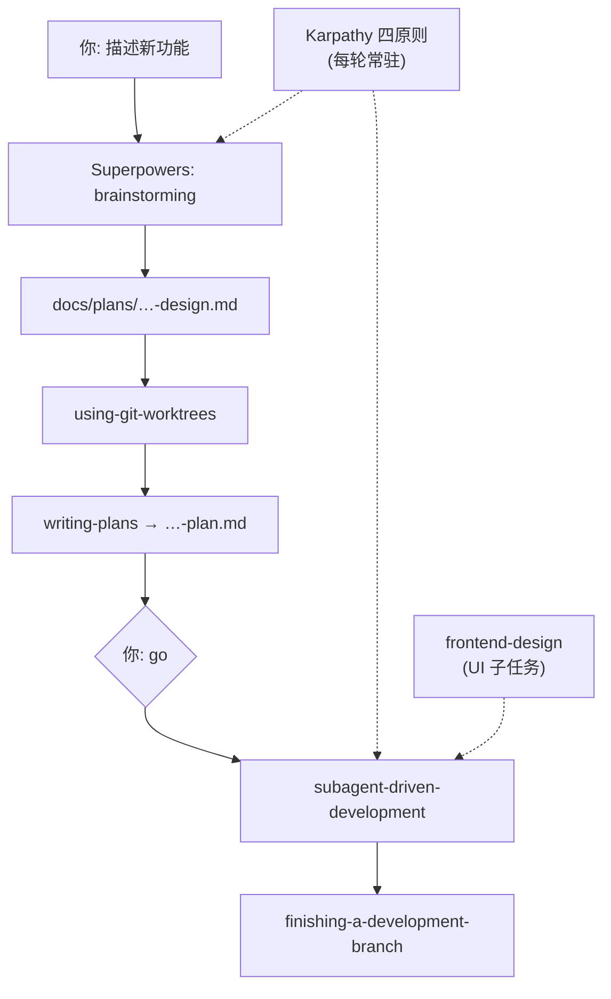

#### 示例会话（摘自 [07 § 7.5](07-工作流方法论-Superpowers.md#75-完整工作流串联) / brainstorming SKILL.md）

```
你: 帮我做一个用户认证功能

Claude: [brainstorming] 这个功能是给什么类型的用户使用的？
        A) 企业内部员工  B) 外部客户  C) 两者都有
你: B

Claude: 需要支持哪些登录方式？
        A) 邮箱+密码  B) 手机验证码  C) OAuth  D) 全部
你: …（一次一个问题，直到设计分块确认）

Claude: 设计写入 docs/plans/2026-06-27-auth-design.md
        Ready to set up for implementation?

你: go

Claude: [writing-plans → subagent-driven-development → 各 Task TDD 执行 …]
        [finishing-a-development-branch] 测试通过 — merge / PR / keep / discard?
```

brainstorming SKILL.md 硬性规则：**一次只问一个问题**、**优先选择题**、设计 **200–300 字一块** 停下确认。若 Claude **直接写代码**，说明 Superpowers hooks 未加载 → `/reload-plugins` 或新会话（07 § 7.6）。

#### 示例会话：端到端含登录页 UI（Superpowers × frontend-design）

同一功能走完整 Superpowers 链；**UI 子任务**在 `writing-plans` 拆出后、执行阶段按 frontend-design 两阶段（先 plan 再 code）。下图是 07 § 7.5 主链 + UI 分支：

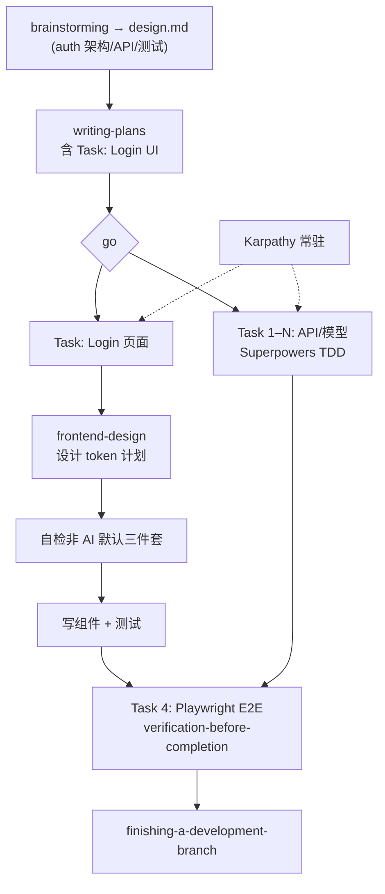

```
── Phase 1–4：与上文「用户认证」示例相同 ──
brainstorming → docs/plans/2026-06-27-auth-design.md
writing-plans → docs/plans/2026-06-27-auth-plan.md
  · Task 1: User 模型 + migration（含失败测试）
  · Task 2: POST /login API（含失败测试）
  · Task 3: Login 页面 UI（frontend-design）

你: go

── execute Task 1–2：Superpowers TDD + Karpathy Goal-Driven ──
Claude: [RED → 看测试失败 → GREEN → REFACTOR；只改 auth 相关文件]

── execute Task 3：frontend-design（摘自 SKILL.md Process）──
你: 实现 Task 3 登录页 UI。按 frontend-design：
     外部 B2B SaaS；单页 job = 完成邮箱登录；
     不要 #F4F1EA+cream serif、不要纯黑+acid green、不要报纸式 broadsheet 默认三件套

Claude: [Pass 1 — 设计计划，非代码]
        Subject: B2B SaaS 登录
        Colors: #0F172A slate bg, #F8FAFC surface, #2563EB CTA, #64748B muted, …
        Type: display = Instrument Sans 600; body = IBM Plex Sans 400
        Layout: 左 40% 价值主张 + 右 60% 表单卡片（ASCII wireframe）
        Signature: 表单区 subtle mesh gradient 边框（非全页 hero 图）
        [自检: 与 brief 一致，非泛化默认 aesthetic]

writing-plans → docs/plans/2026-06-27-auth-plan.md
  · Task 1: User 模型 + migration（含失败测试）
  · Task 2: POST /login API（含失败测试）
  · Task 3: Login 页面 UI（frontend-design）
  · Task 4: Login E2E（Playwright — 见下节）

你: go

── execute Task 1–2：Superpowers TDD + Karpathy Goal-Driven ──
Claude: [RED → 看测试失败 → GREEN → REFACTOR；只改 auth 相关文件]

── execute Task 3：frontend-design（摘自 SKILL.md Process）──
你: 实现 Task 3 登录页 UI。按 frontend-design：
     外部 B2B SaaS；单页 job = 完成邮箱登录；
     不要 #F4F1EA+cream serif、不要纯黑+acid green、不要报纸式 broadsheet 默认三件套

Claude: [Pass 1 — 设计计划，非代码]
        Subject: B2B SaaS 登录
        Colors: #0F172A slate bg, #F8FAFC surface, #2563EB CTA, #64748B muted, …
        Type: display = Instrument Sans 600; body = IBM Plex Sans 400
        Layout: 左 40% 价值主张 + 右 60% 表单卡片（ASCII wireframe）
        Signature: 表单区 subtle mesh gradient 边框（非全页 hero 图）
        [自检: 与 brief 一致，非泛化默认 aesthetic]

你: 计划 OK，写代码

Claude: [Pass 2 — 按修订计划写 Login 组件；Karpathy Surgical：不动 Task 1–2 文件]

── execute Task 4：Playwright E2E（见下节完整示例）──

── 收尾 ──
Claude: [verification-before-completion — 贴出 playwright + unit 命令输出]
        [finishing-a-development-branch] 全 Task 验证通过 → merge / PR?
```

**分工要点**：Superpowers 管 **何时做 UI Task、TDD 顺序**；frontend-design 管 **该页长什么样**；Karpathy 管 **假设、范围、可验证**；不要在 brainstorming 未完成时跳过计划直接 `/` frontend-design。

#### E2E / Playwright 验证（方案 A 怎么写、怎么说）

> 依据：[writing-plans](https://github.com/obra/superpowers/blob/main/skills/writing-plans/SKILL.md) 任务模板（07 § 7.4.5）；[verification-before-completion](https://github.com/obra/superpowers/blob/main/skills/verification-before-completion/SKILL.md)；[Karpathy CLAUDE.md §4](https://github.com/forrestchang/andrej-karpathy-skills/blob/main/CLAUDE.md)；[04 § Product Verification](04-Anthropic内部Skills方法论.md)（Playwright 作验证类 Skill 的 Anthropic 建议）。

**要点**：方案 A **不含** gstack 的 `/qa`（Playwright 守护进程）。E2E 须你在 **brainstorming / writing-plans 阶段** 把 Playwright 写进 `auth-plan.md` 的 **Task N**，每步含 **精确命令 + Expected 输出**（与 unit 测试同一模板）。`verification-before-completion` 要求：**声称 pass 前必须在本消息里跑完命令并贴输出**。

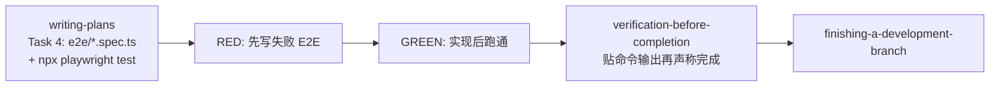

**在 plan 里怎么写 Task 4**（结构摘自 writing-plans SKILL.md / 07 § 7.4.5，命令按项目栈替换）：

```markdown
### Task 4: Login E2E (Playwright)

**Files:**
- Create: `e2e/auth-login.spec.ts`
- Modify: `playwright.config.ts`（若尚无 baseURL）

**Step 1: Write the failing test**
[完整 spec：visit /login → fill email/password → submit → expect dashboard URL]

**Step 2: Run test to verify it fails**
Run: `npx playwright test e2e/auth-login.spec.ts --project=chromium`
Expected: FAIL — login route or selector not found

**Step 3–4: 实现 / 修到 GREEN**（依赖 Task 2–3 已完成）

**Step 5: Run test to verify it passes**
Run: `npx playwright test e2e/auth-login.spec.ts --project=chromium`
Expected: PASS（例如 1 passed）
```

**brainstorming 阶段你可主动要求 E2E**（写入 design/plan，避免 Agent 只写 unit test）：

```
登录功能需要 Playwright E2E：覆盖有效凭证登录、错误密码、空字段。
plan 里要有独立 Task，命令写 npx playwright test，不要写「手动测一下」。
```

**执行 Task 4 时的示例对话**：

```
Claude: [按 plan Step 1 写 e2e/auth-login.spec.ts]
        Run: npx playwright test e2e/auth-login.spec.ts --project=chromium
        → 3 failed（预期：尚未接好 API）

Claude: [接好 Task 2–3 后重跑]
        Run: npx playwright test e2e/auth-login.spec.ts --project=chromium
        → 3 passed

你: 可以收尾了吗？

Claude: [verification-before-completion — 不可先说「Done」]
        Run: npm test && npx playwright test e2e/auth-login.spec.ts --project=chromium
        输出: unit 34/34 pass; playwright 3/3 pass
        → 现在可以 claim：全绿

Claude: [finishing-a-development-branch] merge / PR / keep / discard?
```

**verification-before-completion 铁律**（上游原文）：

```
NO COMPLETION CLAIMS WITHOUT FRESH VERIFICATION EVIDENCE
```

| 可以说 | 不能说（Red Flags） |
|--------|---------------------|
| `Run: npx playwright test …` → 看到 `3 passed` → 「E2E pass」 | 「应该能登录了」「看起来 OK」 |
| 回归：revert fix → 测试 MUST FAIL → restore → pass | 「我写了一个 E2E」但未跑 red-green |

**与 Karpathy 对齐**：「Fix login bug」→ plan 里应是 **「写复现 E2E → 失败 → 修 → 绿」**，不是直接改 DOM（CLAUDE.md §4 Goal-Driven）。

**可选进阶**：按 [04 § Product Verification](04-Anthropic内部Skills方法论.md) 自建 `signup-flow-driver` 类 Skill，把 Playwright 步骤 + 断言写进 SKILL.md；方案 A 默认组合 **不 bundled**，靠 writing-plans 任务即可。

#### 修 Bug

| 步骤 | 做什么 |
|------|--------|
| 1 | 描述现象；Superpowers 应匹配 **systematic-debugging**（见 07 § 7.4）——先稳定复现，再改代码 |
| 2 | Karpathy **Goal-Driven**：「先写复现测试，再修到绿」 |
| 3 | 小改动范围；Karpathy **Surgical** 禁止顺手改无关注释/格式 |

#### 仅做 UI（无新后端逻辑）

可不走完整 Superpowers 计划链，直接：

```
/skills   # 确认 frontend-design Enabled
> 为 [产品/页面] 做 [落地页/仪表盘/组件]，要有独特视觉，避免 Space Grotesk 等默认组合
```

#### 验证本方案是否生效

| 检查 | 通过条件 | 来源 |
|------|----------|------|
| Superpowers | 说 `help me plan a feature` → **先问需求、不写代码** | [07 § 7.6](07-工作流方法论-Superpowers.md#76-安装) |
| brainstorming | `/brainstorming` 或自然语言「帮我做登录」→ 苏格拉底式提问 | Superpowers SKILL.md |
| frontend-design | 要求做 landing page → 先出设计 token/计划再写代码 | frontend-design SKILL.md |
| E2E（若在 plan 中） | 声称完成前贴 `npx playwright test …` 输出 | verification-before-completion SKILL.md |
| Karpathy | 模糊需求时 Agent **先陈述假设或提问**，而非 silent 假设 | CLAUDE.md §1 |

深潜 Superpowers 各 Skill → [07 工作流·Superpowers](07-工作流方法论-Superpowers.md)。

---

## 方案 B：团队协作（⭐⭐⭐⭐）

**适合**：多人仓库、要把 Skill 提交进 git、按 Token 控制描述预算。

| 组件 | 作用 |
|------|------|
| **GSD `--minimal`** | 6 个核心 Skill，上下文工程 |
| **aakash-dhar 精选 4–5 个** | code-review、security-audit、write-tests 等 |

**Skill 预算**：约 10–11

<a id="方案-b-安装"></a>

### 安装

> 多路径规则 → [05 安装手册 § 5.0](05-安装方式参考手册.md)。GSD 细节 → [08 § GSD](08-工作流方法论-四套系统.md#81-gsd--上下文工程与-spec-驱动开发)。

**1. GSD**

- **推荐（`--minimal`）**：与上表一致，6 个核心 Skill，约 700 tokens 冷启动；团队 / 个人都优先这条。
- **备选（全量 86 Skill）**：Sonnet/Opus + 大 context、需要 33 个 subagent 时用；**不要与 `--minimal` 各装一遍**。

**两条 GSD 产品线（勿混装）**

| | **本书推荐：`get-shit-done-cc`** | **备选主线：`@opengsd/gsd-core`** |
|---|-----|-----|
| 安装 | `npx get-shit-done-cc --claude --global --minimal` | `npx @opengsd/gsd-core@latest`（交互选 Runtime） |
| Claude Code 命令 | **`/gsd:new-project`** 等 **冒号** 前缀 | **`/gsd-new-project`** 等 **连字符** 前缀 |
| 维护 | 封装归档仓库安装路径；`--minimal` = 6 Skill | [open-gsd/gsd-core](https://github.com/open-gsd/gsd-core) 2026 起活跃主线 |
| 跨会话恢复 | 读 `.planning/STATE.md`；`/gsd:help` 查可用命令 | `/gsd-progress`、`/gsd-resume-work`（[recover 文档](https://github.com/open-gsd/gsd-core/blob/main/docs/how-to/recover-and-troubleshoot.md)） |
| 本书 | **方案 B / E 路径 B 默认左列** | 已装 gsd-core 时 **工作流相同、命令用右列** |

> 依据：[08 § GSD](08-工作流方法论-四套系统.md#81-gsd--上下文工程与-spec-驱动开发) 冒号命令；[gsd-core COMMANDS.md](https://github.com/open-gsd/gsd-core/blob/main/docs/COMMANDS.md) — Claude Code 用 hyphen form，Gemini 等用 colon form。

```bash
# 推荐 — 个人全局
npx get-shit-done-cc --claude --global --minimal

# 推荐 — 团队：Skill 写入仓库 .claude/skills/ 后 commit
npx get-shit-done-cc --claude --minimal
```

```bash
# 备选 — 全量（交互选 Runtime / Location）
npx get-shit-done-cc@latest
```

**2. aakash-dhar 精选**

- **推荐（团队）**：复制到仓库 `.claude/skills/` 后 commit，全员共享。
- **备选（个人全局）**：复制到 `~/.claude/skills/`。
- **不要装全部 23 个**；按需保留 code-review、write-tests、security-audit 等 4–5 个。

```bash
git clone --depth 1 https://github.com/aakash-dhar/claude-skills.git /tmp/aakash-skills
# 团队（推荐）
cp -r "/tmp/aakash-skills/skills/Development Skills/code-review" .claude/skills/
cp -r "/tmp/aakash-skills/skills/Development Skills/write-tests" .claude/skills/
cp -r "/tmp/aakash-skills/skills/Development Skills/security-audit" .claude/skills/
```

```bash
# 备选 — 个人全局
cp -r "/tmp/aakash-skills/skills/Development Skills/code-review" ~/.claude/skills/
cp -r "/tmp/aakash-skills/skills/Development Skills/write-tests" ~/.claude/skills/
cp -r "/tmp/aakash-skills/skills/Development Skills/security-audit" ~/.claude/skills/
```

**收尾**

```
/skills
/gsd:new-project
/doctor
```

<a id="方案-b-工作流"></a>

### 编程工作流

> 依据：[open-gsd/gsd-core README](https://github.com/open-gsd/gsd-core) phase loop；本书安装路径 `get-shit-done-cc --minimal` 对应命令前缀 `/gsd:`（见 [08 § GSD](08-工作流方法论-四套系统.md#81-gsd--上下文工程与-spec-驱动开发)）；[aakash-dhar/claude-skills code-review SKILL.md](https://github.com/aakash-dhar/claude-skills/blob/main/skills/Development%20Skills/code-review/SKILL.md) 等。若装的是 **gsd-core**，下同步骤把 `/gsd:*` 换成 `/gsd-*`（见上表）。

#### 组件分工

| 组件 | 何时介入 | 触发方式 |
|------|----------|----------|
| **GSD `--minimal`** | 项目级 **phase 循环**（讨论→计划→执行→验证→ship） | User-invoked：`/gsd:new-project`、`/gsd:discuss-phase` 等（6 个核心 Skill） |
| **aakash 精选** | PR 前审查、补测试、安全扫 | Model-invoked：`code-review` 匹配「review this code」；`write-tests` / `security-audit` 按各 SKILL description |

#### 新项目 / 新 Phase（GSD 主线）

GSD Core README 的五步循环（`--minimal` 保留核心命令，无 33 个 subagent，执行可能 in-context 降级，见 08 § `--minimal`）：

```
/gsd:new-project
  → 创建 .planning/PROJECT.md、REQUIREMENTS.md、ROADMAP.md、STATE.md 等

/gsd:discuss-phase
  → 自适应提问 + 代码库侦察 → 产出 {phase}-CONTEXT.md

/gsd:plan-phase
  → 研究（可选）→ PLAN.md → plan-checker 验证 → 迭代

/gsd:execute-phase
  → 按 wave 执行（minimal 模式下无 subagent 时在主会话执行）

/gsd:ship（或仓库内其它 gsd 收尾命令，见 /gsd:help）
  → PR / 归档 phase
```

**团队用法**：Skill 在 `.claude/skills/` 进 git 后，全员同一套 `/gsd:*`；状态文件在 **`.planning/`** 目录跨会话保留（08 § 8.1.3）。

#### 流程图（单 Phase）

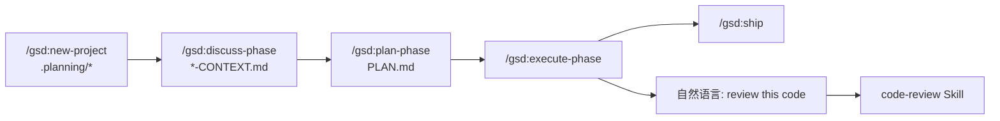

循环来源：[open-gsd/gsd-core README](https://github.com/open-gsd/gsd-core) — Discuss → Plan → Execute → Verify → Ship。

#### 示例会话（命令 + aakash 输出格式）

```
你: /gsd:new-project
Claude: [提问 → 写入 .planning/PROJECT.md、REQUIREMENTS.md、ROADMAP.md、STATE.md]

你: /gsd:discuss-phase
Claude: [代码库侦察 + 灰色区域提问 → 1-auth-CONTEXT.md]

你: /gsd:plan-phase
Claude: [PLAN.md + plan-checker 迭代通过]

你: /gsd:execute-phase
Claude: [按 PLAN 实现；--minimal 时在主会话执行，无 subagent]

你: review this code before I open a PR
Claude: [code-review Skill — 摘自上游输出格式示例]

**[CRITICAL] Security — src/api/auth.ts:42**
SQL 拼接用户输入。Suggested fix: 使用参数化查询。

Summary: Overall assessment — Yes with changes
```

`code-review` 必须带 **File:Line**、严重级别与 **Overall assessment: Yes / Yes with changes / No**（[SKILL.md](https://github.com/aakash-dhar/claude-skills/blob/main/skills/Development%20Skills/code-review/SKILL.md) Output Format）。

#### PR 前质量门（aakash 精选）

在 GSD execute 之后、提 PR 前，用自然语言触发（来自各 SKILL.md 的 description）：

| 意图 | 示例话术 | 期望 Skill |
|------|----------|------------|
| 代码审查 | 「review this code before PR」 / 「check my changes」 | `code-review` → 按 Critical/Warning/Suggestion 分级输出 |
| 补测试 | 「write tests for this module」 | `write-tests` |
| 安全 | 「security audit this API」 | `security-audit` |

`code-review` SKILL.md 规定：先理解上下文 → 七维检查（正确性、安全、性能…）→ 每条带 **File:Line** 与严重级别 → 结尾 **Overall assessment: Yes / Yes with changes / No**。

#### 修 Bug / Phase 内 hotfix（不新开 Phase）

已有 `.planning/` 时，优先走 GSD 调试命令，而不是从零 `/gsd:new-project`。gsd-core [recover 文档](https://github.com/open-gsd/gsd-core/blob/main/docs/how-to/recover-and-troubleshoot.md) 与 08 § 扩展命令：

| 意图 | get-shit-done-cc（冒号） | gsd-core（连字符） |
|------|--------------------------|-------------------|
| 科学调试 | `/gsd:debug "…"` | `/gsd-debug "…"`（`--diagnose` 只分析不修） |
| 小范围定向修 | 继续 `/gsd:execute-phase` 或自然语言指 PLAN | `/gsd-quick "Fix login on mobile Safari"` |
| 执行后验收 | `/gsd:ship` 前 review | `/gsd-verify-work N` |

**无 `.planning/` 的孤立 Bug**（小仓库、未走 GSD 立项）：直接用 aakash `write-tests` + 自然语言修，不必强行 `/gsd:new-project`。

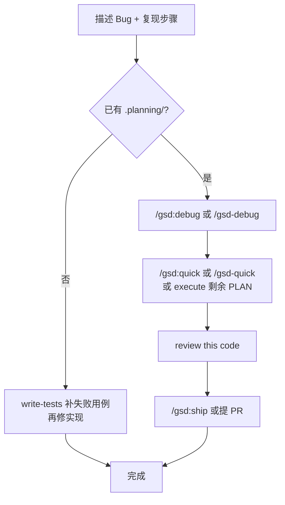

#### 示例会话（Phase 内修 Bug）

```
你: Phase 2 已 execute，Safari 上登录按钮无响应

Claude: [/gsd:debug "login button unresponsive on mobile Safari"]
        [读 PLAN + 变更文件；隔离假设 …]

你: 按 debug 结论修，不要重开整个 phase

Claude: [/gsd:quick "Fix touch handler on LoginButton" — gsd-core 用户]
        或 [在当前 PLAN 范围内 surgical 修改 + 跑测试]

你: review this code before I merge
Claude: [code-review — File:Line + Overall assessment: Yes with changes]
```

#### 跨会话与 compaction 后恢复

GSD 的 `.planning/STATE.md`、`ROADMAP.md`、`*-CONTEXT.md` **设计为跨会话持久**（08 § 8.1.3）。长 `execute-phase` 或 context 满后：

```
/clear                    # 或 compaction 后开新会话
```

**get-shit-done-cc `--minimal`**

```
你: 继续 Phase 2。先读 .planning/STATE.md 和 2-*-CONTEXT.md，告诉我停在哪

Claude: [读 STATE / ROADMAP / CONTEXT → 汇报当前 wave / 未完成项]

你: /gsd:execute-phase     # 或 /gsd:discuss-phase 若决策变了
```

**gsd-core**（[recover 文档](https://github.com/open-gsd/gsd-core/blob/main/docs/how-to/recover-and-troubleshoot.md)）：

```
/gsd-progress             # 或 /gsd-progress --next
/gsd-resume-work          # 从 HANDOFF / STATE 恢复
/gsd-pause-work --report  # 停会话前可选：写 HANDOFF + 报告
```

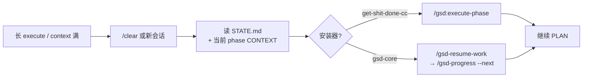

#### 与方案 A 的差异

- **无** Superpowers 强制 brainstorming/TDD 链；纪律来自 **GSD 文件化上下文** + aakash 审查 Skill。
- 需要「idea→ship 全自动编排」选方案 A；需要 **`.planning/` 进 git、团队共享 phase** 选本方案。

GSD 命令与标志深潜 → [08 工作流·四套系统](08-工作流方法论-四套系统.md) § GSD。

---

## 方案 C：快速原型 / 产品验证（⭐⭐⭐⭐）

**适合**：CEO/产品视角、多角色评审、快速 ship。

| 组件 | 作用 |
|------|------|
| **gstack 精选** | /office-hours、/plan-ceo-review、/review、/ship |
| **frontend-design + ui-ux-pro-max 主 Skill** | 各 1 个，不要装 Pro Max 全部 7 子 Skill |

<a id="方案-c-安装"></a>

### 安装

> gstack → [08 § gstack](08-工作流方法论-四套系统.md#82-gstack--虚拟工程团队)；frontend / Pro Max → [09 章](09-领域Skill-前端与UI.md)。

**1. gstack**

- **唯一路径（git + setup）**：无 npx / CC Switch；必须 clone 后跑 `./setup`。
- **推荐（个人全局）**：Skill 装到 `~/.claude/skills/gstack`。
- **备选（团队）**：同一 clone 目录执行 `./setup --team`，`.claude/` 片段进 git（见上游 README）。

```bash
# 推荐 — 个人全局
git clone --single-branch --depth 1 https://github.com/garrytan/gstack.git ~/.claude/skills/gstack
cd ~/.claude/skills/gstack && ./setup
/skills
/office-hours
```

```bash
# 备选 — 团队
(cd ~/.claude/skills/gstack && ./setup --team)
```

**2. frontend-design**

- **推荐（CC Switch 用户）**：`install` + `sync` 管单体 Skill。
- **备选（终端 / 无 CC Switch）**：`npx skills add`；**不要两条都跑**。

```bash
# 推荐（CC Switch）
cc-switch skills install anthropics/skills:frontend-design && cc-switch skills sync
```

```bash
# 备选（npx）
npx skills add anthropics/skills --skill frontend-design -g -a claude-code -y
```

**3. UI/UX Pro Max 主 Skill**

- **推荐 A（`uipro init`）**：方案 C 只要**主 Skill** `ui-ux-pro-max`；上游标准流程，会写入数据脚本与 Python 引擎到 `.claude/skills/`。
- **备选 B（Claude Code Plugin）**：习惯所有能力走 `/plugin`、要 `/plugin update` 一键更新时用。
- **备选 C（npx / CC Switch 仅主目录）**：用 CC Switch 管 Skill，或不想装全局 `ui-ux-pro-max-cli` 时。
- **A / B / C 只选一条**；**不要**把 7 个子 Skill 全装进描述预算。详述 → [09 § 9.2](09-领域Skill-前端与UI.md#92-uiux-pro-max--全套设计基础设施)。

```bash
# A. uipro CLI（推荐）
npm install -g ui-ux-pro-max-cli
uipro init --ai claude
```

```
# B. Plugin（备选）
/plugin marketplace add nextlevelbuilder/ui-ux-pro-max-skill
/plugin install ui-ux-pro-max@ui-ux-pro-max-skill
/reload-plugins
```

```bash
# C.1 推荐（CC Switch）
cc-switch skills install nextlevelbuilder/ui-ux-pro-max-skill:ui-ux-pro-max && cc-switch skills sync
```

```bash
# C.2 备选（npx）
npx skills add nextlevelbuilder/ui-ux-pro-max-skill --skill ui-ux-pro-max -g -a claude-code -y
```

**收尾**

```
/skills
/doctor
```

<a id="方案-c-工作流"></a>

### 编程工作流

> 依据：[garrytan/gstack README](https://github.com/garrytan/gstack) Quick start、Sprint 表、[docs/skills.md `/office-hours`](https://github.com/garrytan/gstack/blob/main/docs/skills.md)；[frontend-design SKILL.md](https://github.com/anthropics/skills/blob/main/skills/frontend-design/SKILL.md)；[ui-ux-pro-max-skill README Usage](https://github.com/nextlevelbuilder/ui-ux-pro-max-skill)。

#### 组件分工

| 组件 | 何时介入 | 触发方式 |
|------|----------|----------|
| **gstack** | 产品定义 → 多角色评审 → 实现 → 审查 → QA → 发布 | **User-invoked slash**（`/office-hours` 等 23 个命令） |
| **frontend-design** | 审美方向、反 AI 模板化 | Model-invoked；UI 任务时自动或 prompt 点名 |
| **ui-ux-pro-max** | 设计系统参数（色板、字体、布局模式） | Claude Code 下 **Skill 模式自动激活**（README：「request any UI/UX work」）；或 `/ui-ux-pro-max …`（Workflow 模式 Agent） |

gstack README：**「Think → Plan → Build → Review → Test → Ship → Reflect」**；每个 Skill 读取上一步产出（如 `/office-hours` 设计 doc → `/plan-ceo-review` 读取）。

#### 标准 Sprint（上游 Quick start + README 示例）

```
/office-hours
  → 六问 forcing questions（Startup）或 Builder 模式；设计 doc 写入 ~/.gstack/projects/
  → 下游 /plan-ceo-review、/plan-eng-review 自动读此 doc

/plan-ceo-review
  → 创始人视角：Expansion / Hold Scope / Reduction 等模式审视范围

/plan-eng-review
  → 锁架构、数据流 ASCII、边界情况、测试矩阵

（实现：退出 plan mode，按 eng review 文档写代码）

/review
  → Staff Engineer 审查；明显问题 AUTO-FIX，其余 ASK

/qa https://your-staging-url
  → Playwright 真浏览器；find-fix-verify 闭环

/ship
  → 跑测试、覆盖率、开 PR（README 示例：Tests 42→51，PR 链接）
```

README **Quick start** 建议新手先跑到 `/qa` 为止评估是否适合，不必一次跑完全部 23 命令。

#### 流程图（Sprint 主链）

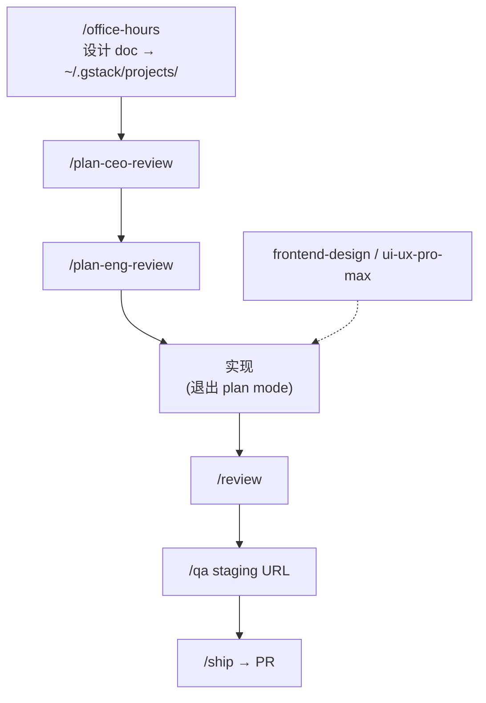

主链顺序来自 [gstack README Sprint 表](https://github.com/garrytan/gstack/blob/main/README.md) 与 [docs/skills.md](https://github.com/garrytan/gstack/blob/main/docs/skills.md)：`office-hours → plan → implement → review → QA → ship → retro`。

#### 示例会话（摘自 [gstack README「See it work」](https://github.com/garrytan/gstack#see-it-work)）

```
你: 我想做一个日历每日简报 app
你: /office-hours

Claude: [追问具体痛点 — 非假设性场景]
你: 多个 Google 日历、信息 stale、地点错误、prep 文档质量差…

Claude: 我要 push back 你的 framing — 你要的不是「日历 app」，
        而是 personal chief of staff AI。
        [提取 5 项能力、挑战 4 条 premise、2–3 种实现路径 + 工作量]
        RECOMMENDATION: 先 ship 最窄 wedge（每日简报），CRM 第二周再加。
        [写入设计 doc]

你: /plan-ceo-review
你: /plan-eng-review
你: Approve plan. Exit plan mode.
     [实现 …]

你: /review
Claude: [AUTO-FIXED] 2 issues. [ASK] race condition → 你确认

你: /qa https://staging.myapp.com
你: /ship
Claude: Tests: 42 → 51 (+9). PR: github.com/you/app/pull/42
```

#### UI 双 Skill 怎么配合（09 § 9.2 与上游一致）

| 阶段 | 用谁 | 怎么说 |
|------|------|--------|
| 定方向 | **frontend-design** | 「landing page for X，distinctive aesthetic，不要默认 AI 三件套」 |
| 要精确 token | **ui-ux-pro-max** | 「Build a landing page for my SaaS product」（README 示例）→ 推理引擎出 styles/colors/typography |
| 两者组合 | 先 frontend-design 定 **方向**，Pro Max 出 **hex/字体名/布局模式** | 09 章定位差异 |

Pro Max README **How It Works**：Ask → Design System Generated → Smart recommendations → Code → Pre-delivery checks（对比度、cursor-pointer、reduced-motion 等）。

#### 流程图（Sprint 之后：BUILD 阶段的 UI 双 Skill）

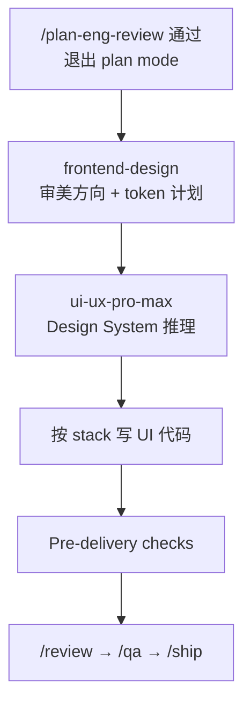

#### 示例 A：Pro Max README 主示例逐步（「SaaS landing page」）

上游原文 prompt（[README Usage · Example Prompts](https://github.com/nextlevelbuilder/ui-ux-pro-max-skill#example-prompts)）：

```
Build a landing page for my SaaS product
```

Claude Code 下 **Skill 模式自动激活**（README：「request any UI/UX work」）。逐步对应 README **How It Works** 五步 + [09 § 9.2 推理示例](09-领域Skill-前端与UI.md#92-uiux-pro-max--全套设计基础设施)：

| 步 | README 阶段 | 实际发生什么（上游文档） |
|----|-------------|-------------------------|
| 1 | **You ask** | 你发出上句 prompt；可追加 stack：`… using Next.js and Tailwind`（README Supported Stacks） |
| 2 | **Design System Generated** | 推理引擎并行查 `styles.csv` / `colors.csv` / `typography.csv` / `landing.csv` / `products.csv` 等 |
| 3 | **Smart recommendations** | 输出模式、风格名、**具体 hex**、字体名、落地页布局模式（非模糊「现代简约」） |
| 4 | **Code generation** | 按选定 stack 生成页面；默认 HTML + Tailwind，prompt 可指定 React/Next 等 |
| 5 | **Pre-delivery checks** | 对照反模式清单（见下表） |

**第 3 步输出形态示例**（与 09 § 9.2 同源，产品类型换为 SaaS 时引擎仍走同一 pipeline；以下为 spa 场景的**上游文档记录示例**，说明输出粒度）：

```
模式：Hero-Centric + Social Proof
风格：Soft UI Evolution
色板：Primary #E8B4B8 / Secondary #A8D5BA / CTA #D4AF37
字体：Cormorant Garamond / Montserrat
避免：霓虹色、锐利动画、暗色模式（引擎「避免模式」字段）
```

**第 5 步 Pre-delivery checks**（09 § 9.2 / 上游工作流清单，执行前逐项过）：

| 检查项 | 要求 |
|--------|------|
| 图标 | 不用 emoji 当图标 → SVG（Heroicons/Lucide） |
| 交互 | 可点击元素 `cursor-pointer` |
| 动效 | Hover 150–300ms；尊重 `prefers-reduced-motion` |
| 无障碍 | 浅色文字对比度 ≥ 4.5:1；Focus 可见 |
| 响应式 | 375 / 768 / 1024 / 1440 px |

**CLI 直调设计系统（可选）** — README [Design System Command](https://github.com/nextlevelbuilder/ui-ux-pro-max-skill#design-system-command-advanced)：

```bash
python3 .claude/skills/ui-ux-pro-max/scripts/search.py "SaaS dashboard" --design-system --persist -p "MyApp"
# → design-system/MASTER.md（跨会话复用）
```

#### 示例 D：`design-system/MASTER.md` 跨会话复用（完整对话）

> 依据：[ui-ux-pro-max-skill README · Persist Design System](https://github.com/nextlevelbuilder/ui-ux-pro-max-skill#persist-design-system-master--overrides-pattern)（Master + Overrides 分层；Context-aware retrieval prompt 为 README 原文）。

**目录结构（上游）**：

```
design-system/
├── MASTER.md           # 全局 Source of Truth（色/字/间距/组件）
└── pages/
    └── dashboard.md    # 仅写与该页不同的 override（可选）
```

**分层规则**：做 Checkout 页时先读 `pages/checkout.md`；若存在则 **override** MASTER；不存在则 **只用 MASTER**。

---

**会话 1 — 生成并持久化（README 命令原文）**

```
你: 为 MyApp 这个 B2B SaaS 生成设计系统并持久化到仓库

Claude: [ui-ux-pro-max — 运行推理引擎]

你: （或你本地先跑 CLI，再让 Agent 读文件）
     python3 .claude/skills/ui-ux-pro-max/scripts/search.py \
       "SaaS dashboard" --design-system --persist -p "MyApp"

Claude: 已写入 design-system/MASTER.md
        [内容含：色板 hex、字体名、spacing scale、组件 token 等 — 来自引擎输出]

你: 再加 dashboard 页的 page override

     python3 .claude/skills/ui-ux-pro-max/scripts/search.py \
       "SaaS dashboard" --design-system --persist -p "MyApp" --page "dashboard"

Claude: 已写入 design-system/pages/dashboard.md
        （仅 dashboard 与 MASTER 不同的规则；其余继承 MASTER）

你: git add design-system/ && git commit -m "chore: add Pro Max design system"
```

---

**会话 2 — 新 Claude Code 会话，做 Pricing 页（README Context-aware retrieval prompt 原文）**

```
你: I am building the Pricing page. Please read design-system/MASTER.md.
     Also check if design-system/pages/pricing.md exists.
     If the page file exists, prioritize its rules.
     If not, use the Master rules exclusively.
     Now, generate the code for a Next.js + Tailwind pricing page with three tiers.

Claude: [读 MASTER.md — 无 pages/pricing.md]
        使用 MASTER 的 primary #2563EB、Instrument Sans / IBM Plex Sans、spacing…
        [生成 app/pricing/page.tsx]
        [Pre-delivery checks：cursor-pointer、focus、对比度、375–1440 断点]

你: Build a landing page for my SaaS product
     Stack: Next.js + Tailwind. Follow design-system/MASTER.md only.

Claude: [同一 MASTER；landing 与 pricing 视觉一致 — 不重新发明色板]
```

---

**会话 3 — 已有 dashboard override 时（分层检索）**

```
你: I am building the Dashboard page. Please read design-system/MASTER.md.
     Also check if design-system/pages/dashboard.md exists.
     If the page file exists, prioritize its rules.
     If not, use the Master rules exclusively.
     Now, generate the analytics dashboard layout.

Claude: [读 MASTER.md + pages/dashboard.md]
        MASTER 定全局色/字；dashboard.md override 例如「图表区用 compact density、sidebar 固定 240px」
        [生成 dashboard UI；override 优先于 MASTER 冲突项]
```

**不要**：每个新会话都重新 `Build a landing page…` 却不读 `design-system/` — 会丢跨会话一致性，也浪费 token 重新推理。MASTER 的价值是 **磁盘 = 设计 SSOT**（与 planning-with-files 三文件思路同构，见方案 E）。

**与 frontend-design 组合**：会话 1 若 aesthetic 方向未定，可先走 frontend-design Pass 1 定 signature，再 `--persist` 把 **数值 token** 写入 MASTER；会话 2+ 只读文件即可。

#### 示例 B：gstack Sprint 结束后接 UI 双 Skill

在 [上文 gstack 示例会话](#示例会话摘自-gstack-readmesee-it-work) 的 `Approve plan. Exit plan mode.` 之后：

```
── BUILD：先方向，再参数 ──

你: 按 frontend-design：为这款 daily briefing SaaS 做 marketing landing，
     受众是 busy founders；要 distinctive，不要 cream+serif+terracotta 默认 AI 风

Claude: [frontend-design Pass 1 — 4–6 色 hex、字体配对、布局 ASCII、signature；
         对照 brief 自检非泛化 aesthetic]
你: OK

你: Build a landing page for my SaaS product
     Stack: Next.js + Tailwind. Use the design direction we just agreed.

Claude: [ui-ux-pro-max — Design System Generated → 具体 token 与 landing 模式]
        [Code generation]
        [Pre-delivery checks 勾选上表]

你: /review
你: /qa https://staging.myapp.com
你: /ship
```

**顺序不要反**：先 frontend-design 定 **审美与 brief 对齐**；再用 Pro Max 同一 README prompt 出 **可执行的 design system + 代码**。两条都装时 **不要** 跳过 Pass 1 直接让 Pro Max 生成，否则容易回到「泛化 SaaS 模板」。

#### 示例 C：README 其它 Example Prompts 速查

均来自 [README Example Prompts](https://github.com/nextlevelbuilder/ui-ux-pro-max-skill#example-prompts)；Skill 模式下发 **同一句即可**，引擎按 `products.csv` 等匹配类别：

| Prompt（原文） | 引擎侧重（How It Works + 数据目录） | 可与 frontend-design 叠加 |
|----------------|-------------------------------------|---------------------------|
| `Create a dashboard for healthcare analytics` | 产品类 healthcare + `charts.csv` 图表类型 + dashboard 布局 | 先定「clinical trust、非娱乐化」方向 |
| `Design a portfolio website with dark mode` | `styles.csv` dark 风格 + `typography.csv` | 先定 signature 元素（dark 但非纯黑+acid green 默认） |
| `Make a mobile app UI for e-commerce` | `stacks/react-native` 等 + `products.csv` e-commerce | 移动断点 375px 优先 |
| `Build a fintech banking app with dark theme` | README CLI 示例域 `fintech banking` + 安全/信任色板 | 先 frontend-design 约束「可信、非 crypto 霓虹」 |

Workflow 模式 Agent（Kiro/Copilot 等）改用 slash（README）：`/ui-ux-pro-max Build a landing page for my SaaS product`；方案 C 在 Claude Code 默认走 **Skill 自动激活**，不必 slash。

#### 可选 gstack 命令（按 README Sprint 表）

| 场景 | 命令 |
|------|------|
| 安全审计 | `/cso`（OWASP + STRIDE；**不是** `/codex` 第二意见） |
| Codex 第二意见 | `/codex` |
| 部署 | `/land-and-deploy` |
| 回顾 | `/retro` |

gstack 命令全文 → [08 § gstack](08-工作流方法论-四套系统.md#82-gstack--虚拟工程团队) · [docs/skills.md](https://github.com/garrytan/gstack/blob/main/docs/skills.md)。

---

## 方案 D：最少组合（⭐⭐⭐⭐⭐ 入门首选）

**适合**：第一次玩 Skill、描述预算最省、先建立肌肉记忆。

| Skill | 作用 |
|-------|------|
| **grill-me** | 需求澄清 |
| **frontend-design** | UI |
| **Karpathy 四原则** | 编码行为 |

**Skill 预算**：约 3

<a id="方案-d-安装"></a>

### 安装

> Matt / Karpathy 细节 → [08 § mattpocock / Karpathy](08-工作流方法论-四套系统.md)。

**1. 单体 Skill（grill-me + frontend-design）**

- **推荐（CC Switch 用户）**：两条都用 `cc-switch skills install … && cc-switch skills sync`。
- **备选（终端 / 无 CC Switch）**：下面两条 `npx`；**不要 CC Switch 与 npx 混装同一 Skill**。

```bash
# 推荐（CC Switch）
cc-switch skills install mattpocock/skills:grill-me && cc-switch skills sync
cc-switch skills install anthropics/skills:frontend-design && cc-switch skills sync
```

```bash
# 备选（npx）
npx skills add mattpocock/skills --skill grill-me -g -a claude-code -y
npx skills add anthropics/skills --skill frontend-design -g -a claude-code -y
```

**2. Karpathy 四原则**

- **推荐 A（Plugin 全局）**：入门方案跨项目用，四条原则 **User scope 装一次** 即可。
- **备选 B（单项目 `CLAUDE.md`）**：只约束当前仓库或要 **git 共享规则**；**不要与 A 双装**。

```
# A. Plugin 全局（推荐）
/plugin marketplace add forrestchang/andrej-karpathy-skills
/plugin install andrej-karpathy-skills@karpathy-skills
/reload-plugins
```

```bash
# B. 单项目 CLAUDE.md（备选）
curl -o CLAUDE.md https://raw.githubusercontent.com/forrestchang/andrej-karpathy-skills/main/CLAUDE.md
```

**收尾**

```
/skills
/grill-me
/doctor
```

<a id="方案-d-工作流"></a>

### 编程工作流

> 依据：[mattpocock/skills README](https://github.com/mattpocock/skills)（grill-me 为 **User-invoked**，Matt 称最受欢迎）；[frontend-design SKILL.md](https://github.com/anthropics/skills/blob/main/skills/frontend-design/SKILL.md)；[Karpathy CLAUDE.md](https://github.com/forrestchang/andrej-karpathy-skills/blob/main/CLAUDE.md)。

#### 组件分工

| 组件 | 何时介入 | 触发方式 |
|------|----------|----------|
| **grill-me** | **动手前**澄清需求（无代码库、不写入文件） | **仅** `/grill-me`（User-invoked） |
| **frontend-design** | 做 UI 时 | Model-invoked 或 prompt 点名 |
| **Karpathy** | 写代码全程 | 常驻四条原则 |

mattpocock README / 08 § 8.3：`grill-me` 背后是 model-invoked **`grilling`**（一次一个问题、给推荐答案）；与 **`grill-with-docs`** 不同——后者要代码库并写 CONTEXT.md，**本方案未装**。

#### 新功能（推荐顺序）

```
1. /grill-me
   → 澄清「要做什么、边界、成功标准」；grilling 循环，一次一问
   → 不产出 PRD/本地文件（stateless）

2. （可选）若涉及 UI：
   > 按 frontend-design：先给设计 token 计划（色/字/布局/signature），确认后再写代码

3. 普通实现对话
   → Karpathy 自动：不确定先问、最简实现、只改相关行、可验证目标（测试优先）

4. 会话太长时
   → 可开新会话，用自然语言摘要 grill-me 结论（本方案未装 handoff Skill）
```

**不要**在已 `/grill-me` 澄清后又说「帮我做登录」指望 Superpowers 式全自动链——本方案 **没有** Superpowers Plugin。

#### 流程图

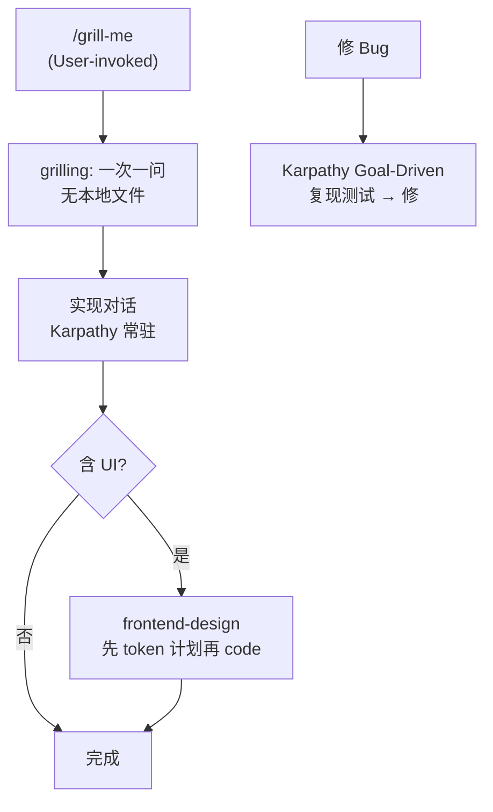

#### 示例会话（grill-me + frontend-design，行为来自 mattpocock README / frontend-design SKILL.md）

```
你: /grill-me
     我想给现有 SaaS 加一个团队邀请功能

Claude: [grilling — 只问一个问题，并给推荐答案]
        邀请是 email 链接还是管理员批量导入？
        推荐: email 链接（实现更简单，符合自助 onboarding）

你: 同意 email 链接

Claude: [继续一问一答，直到决策树走完 …]
        总结: 范围、边界、成功标准

你: 按 frontend-design：为邀请流程做 onboarding UI，
     不要 cream+serif+terracotta 那套默认 AI 三件套

Claude: [frontend-design — 先输出 4–6 色 hex、字体配对、布局 ASCII、signature 元素]
        [你确认后再写组件代码]
        [Karpathy: 只改邀请相关文件，先写失败测试再实现]
```

grill-me 与 grill-with-docs 的区别（[08 § 8.3](08-工作流方法论-四套系统.md)）：本方案 **无代码库文档输出**；有仓库且要 CONTEXT.md 应另装 `grill-with-docs`（超出方案 D 预算）。

#### 仅修 Bug / 小改（独立路径）

**跳过** `/grill-me`（mattpocock / planning-with-files 同类原则：单文件、现象明确时不必澄清循环）。Karpathy CLAUDE.md §4 **Goal-Driven**：先可验证目标（失败测试 / 复现步骤），再 surgical 修改。


#### 示例会话（仅修 Bug）

```
你: 生产上 /api/invite 返回 500，本地 curl 可复现：
     curl -X POST localhost:3000/api/invite -d '{"email":"a@b.com"}'

Claude: [Karpathy — 先问缺失假设若必要；否则直接]
        我先加 integration test 锁定 500，再查 handler

你: 只改 invite 相关文件，不要动 auth 模块

Claude: [失败测试 → 修 handler → 测试绿]
        Root cause: 未校验 email 格式导致 DB constraint；已加校验 + 测试
```

#### 仅做 UI（独立路径）

不必 `/grill-me`，除非页面目标模糊。直接点名 frontend-design（SKILL.md：先 Purpose / Tone / 差异化，再 code）。

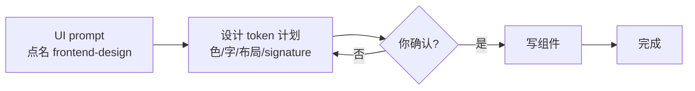

#### 示例会话（仅做 UI）

```
你: Build a pricing page for a developer-tools SaaS.
     Use frontend-design — brutalist/raw tone, dark theme,
     no purple gradients or Inter.

Claude: [frontend-design — 先输出调性、hex 色板、字体配对、布局 ASCII、1 个 signature 元素]
        确认后我再写 React 组件

你: 确认，用 Tailwind

Claude: [实现 PricingPage；Karpathy: 只新增 pricing 路由与组件，不动 billing 逻辑]
```

#### 验证

| 检查 | 通过条件 |
|------|----------|
| grill-me | `/grill-me` → **一次只问一个问题**，有推荐选项 |
| frontend-design | 要求做页面 → **先设计计划再 code** |
| Karpathy | 模糊需求 → **先问假设**，不大段无关重构 |

Matt 完整工程流（tdd、triage、implement…）需额外装 Skill → [08 § mattpocock](08-工作流方法论-四套系统.md#83-mattpocockskills--反-vibe-coding-工程工作流)。

---

## 方案 E：Token 敏感（本地 LLM / 按量 API）

**Skill 预算**：约 5

| 组件 | 作用 |
|------|------|
| **Caveman** | 压缩 Agent 输出 Token |
| **grill-me** | 需求澄清 |
| **Karpathy** | 行为约束（Plugin 或 CLAUDE.md 二选一） |
| **planning-with-files** 或 **GSD `--minimal`** | 持久化计划（**二选一**，不要都装） |

<a id="方案-e-安装"></a>

### 安装

> Caveman / planning-with-files → [11 生态索引](11-生态索引.md)；GSD → [08 § GSD](08-工作流方法论-四套系统.md)。

**1. Caveman + grill-me（单体 Skill）**

- **推荐（CC Switch 用户）**：两条都用 `install` + `sync`。
- **备选（终端 / 无 CC Switch）**：下面两条 `npx`；**不要 CC Switch 与 npx 混装同一 Skill**。

```bash
# 推荐（CC Switch）
cc-switch skills install JuliusBrussee/caveman:caveman && cc-switch skills sync
cc-switch skills install mattpocock/skills:grill-me && cc-switch skills sync
```

```bash
# 备选（npx）
npx skills add JuliusBrussee/caveman -g -a claude-code -y
npx skills add mattpocock/skills --skill grill-me -g -a claude-code -y
```

**2. Karpathy 四原则**

- **推荐 A（Plugin 全局）**：跨项目行为约束，User scope 装一次。
- **备选 B（单项目 `CLAUDE.md`）**：只约束当前仓库或 git 共享规则；**不要与 A 双装**。

```
# A. Plugin 全局（推荐）
/plugin marketplace add forrestchang/andrej-karpathy-skills
/plugin install andrej-karpathy-skills@karpathy-skills
/reload-plugins
```

```bash
# B. 单项目 CLAUDE.md（备选）
curl -o CLAUDE.md https://raw.githubusercontent.com/forrestchang/andrej-karpathy-skills/main/CLAUDE.md
```

**3. 计划持久化**

- **推荐 A（`planning-with-files`）**：最轻，Manus 三文件，Skill 预算更省（与 GSD 流程无关时首选）。
- **备选 B（GSD `--minimal`）**：要和方案 B 同一套 GSD 命令链时用；**不要与 A 同时装**。

若选 **B**，安装与命令形态同 [方案 B GSD 对照表](#方案-b-安装)（`get-shit-done-cc` → `/gsd:*`；`gsd-core` → `/gsd-*`）。

```bash
# A. planning-with-files（推荐）
npx skills add OthmanAdi/planning-with-files -g -a claude-code -y
```

```bash
# B. GSD minimal（备选）
npx get-shit-done-cc --claude --global --minimal
```

<a id="方案-e-工作流"></a>

### 编程工作流

> 依据：[JuliusBrussee/caveman README](https://github.com/JuliusBrussee/caveman)；[mattpocock/skills grill-me](https://github.com/mattpocock/skills)；[OthmanAdi/planning-with-files README](https://github.com/OthmanAdi/planning-with-files)；Karpathy CLAUDE.md。计划持久化 **A/B 二选一**。

#### 组件分工

| 组件 | 作用 | 触发 |
|------|------|------|
| **Caveman** | 压缩 **输出** Token（README：平均 ~65% output 减少；**不影响** reasoning tokens） | `/caveman [lite\|full\|ultra\|wenyan]` 或说 "talk like caveman"；Claude Code 装 Plugin/hook 时可会话自动激活（见上游 INSTALL.md） |
| **grill-me** | 动手前澄清 | `/grill-me` |
| **Karpathy** | 编码约束 | 常驻 |
| **planning-with-files（A）** | 三文件持久化计划 | Model-invoked + hooks；复杂任务自动建 `task_plan.md` / `findings.md` / `progress.md` |
| **GSD `--minimal`（B）** | 同方案 B 的 `/gsd:*` phase 循环 | User-invoked |

#### 推荐会话顺序（planning-with-files 路径 A）

```
/skills && /doctor

/caveman lite          # 或 full；README：lite=去 filler，full=默认 caveman
                       # 停： "normal mode"

/grill-me              # 复杂新任务先澄清；简单单文件编辑可跳过

> [你的任务描述]
  → planning-with-files 匹配「multi-step / research / building」时：
     创建 task_plan.md、findings.md、progress.md（README Key Rules）
     PreToolUse/PostToolUse/Stop hooks 重读计划、提醒更新、完成前校验

（实现阶段 Karpathy + Caveman 同时生效：mouth 小、改动 surgical、目标可测）
```

#### 流程图（路径 A：planning-with-files）

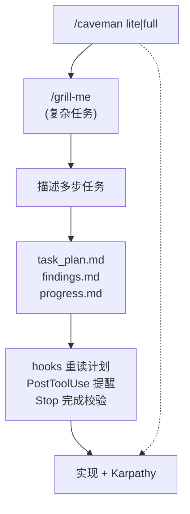

#### 示例：Caveman 输出对比（摘自 [caveman README Before/After](https://github.com/JuliusBrussee/caveman#before--after)）

**Normal（69 tokens 量级）**

> The reason your React component is re-rendering is likely because you're creating a new object reference on each render cycle… I'd recommend using useMemo to memoize the object.

**Caveman（19 tokens 量级）**

> New object ref each render. Inline object prop = new ref = re-render. Wrap in `useMemo`.

触发：`/caveman` 或 "talk like caveman"；停止："normal mode"（README Install 节）。

#### 示例：planning-with-files 三文件（摘自 [README Usage + Key Rules](https://github.com/OthmanAdi/planning-with-files)）

```
你: 重构 auth 模块并补集成测试（多步、跨会话）

Claude: [匹配 planning-with-files — 先建三文件，无 task_plan.md 不开工]

task_plan.md   → Phase 1 审计 / Phase 2 测试 / Phase 3 重构 [ ]
findings.md    → 每 2 次 read/grep 后写入发现（2-Action Rule）
progress.md    → 会话 log、错误、测试结果

[Stop hook: 未勾完 phase 时会提醒；/clear 后 session recovery 可读回文件]
```

**Skip**（上游 When to Use）：简单问答、单文件小改、快速 lookup — 不必走三文件。

**planning-with-files Key Rules**（上游 README）：① 无 `task_plan.md` 不开工；② **2-Action Rule**——每 2 次 view/browser 操作把发现写入 `findings.md`；③ 错误记入 plan；④ 不重复失败路径。

**npx 单体安装 note**（上游 v2.42）：`npx skills add` **不含** Plugin 专属 `/plan-goal`、`/plan-loop`；核心仍是三文件 + hooks。要完整 slash 包装用 `/plugin install`（见 [11 § 11.5](11-生态索引.md)）。

#### 备选：GSD minimal 路径 B

与 [方案 B 编程工作流](#方案-b-工作流) 相同 phase 循环，但在本方案前 **先开 Caveman + grill-me**。`.planning/` 替代三文件（**不要与 planning-with-files 同时装**）。

**推荐会话顺序（路径 B）**

```
/skills && /doctor
/caveman lite
/grill-me                    # 复杂多 phase 项目先澄清
/gsd:new-project             # gsd-core 用户: /gsd-new-project
/gsd:discuss-phase → plan → execute
/clear                       # Token 敏感：phase 间清 context
/gsd:resume-work 或读 STATE  # gsd-core；get-shit-done-cc 读 STATE 后继续 execute
```

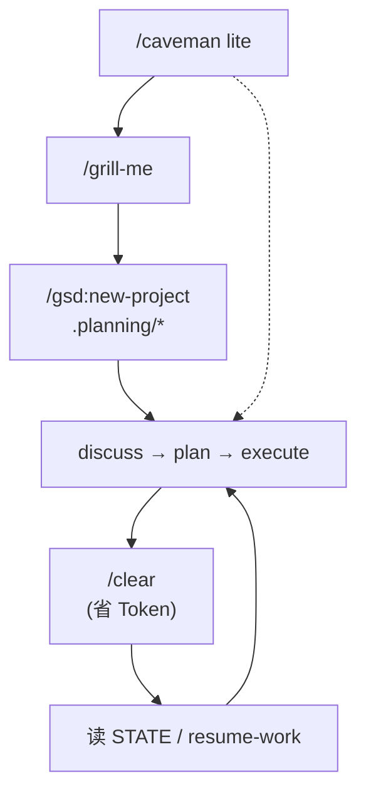

#### 示例会话（路径 B：Caveman + GSD minimal）

```
你: /caveman lite
你: /grill-me
     要把单体 auth 拆成独立 service，3 个 phase

Claude: [grilling 一问一答 … 总结 scope]

你: /gsd:new-project
Claude: [写入 .planning/PROJECT.md、REQUIREMENTS.md、ROADMAP.md、STATE.md]

你: /gsd:discuss-phase
Claude: [1-split-CONTEXT.md — 拆服务边界决策]

你: /gsd:plan-phase
Claude: [PLAN.md；--minimal 在主会话执行]

你: /gsd:execute-phase
Claude: [短回复 — Caveman 生效；按 PLAN 改代码]

你: /clear
你: 读 STATE.md，继续 phase 1 剩余 wave

Claude: [从 .planning/ 恢复，不重复 grill-me]
```

路径 B 的 Bug / 跨会话细节 → [方案 B § 修 Bug](#方案-b-工作流) · [§ 跨会话恢复](#方案-b-工作流)。

#### Caveman 使用注意（README IMPORTANT）

- 只减 **输出** token，不减思考 token；主要收益是 **可读性 + 速度**，省钱是副产品。
- 子命令 `/caveman-commit`、`/caveman-review` 等需完整 caveman 包；本方案只装主 `caveman` Skill 时以 `/caveman` 为主。

#### 验证

| 检查 | 通过条件 |
|------|----------|
| Caveman | `/caveman` 后回复变短、技术内容保留 |
| planning-with-files | 多步任务后项目根出现 **三文件** 且有 checkbox 进度 |
| GSD 路径 B | `.planning/` 出现且 `/gsd:*` 或 `/gsd-*` 可跑通 |
| grill-me | 同方案 D |

**收尾**

```
/skills
/doctor
```

---

## 社区大神怎么配（参考，不是必装）

| 人物 | 组合要点 | 深入阅读 |
|------|----------|----------|
| Jesse Vincent | Superpowers 7 阶段 | [07 工作流·Superpowers](07-工作流方法论-Superpowers.md) |
| Matt Pocock | grill-me + tdd + triage | [08 工作流·四套](08-工作流方法论-四套系统.md) |
| Garry Tan | gstack Sprint | [08 工作流·四套](08-工作流方法论-四套系统.md) |
| TÂCHES | GSD + `--minimal` | [08 工作流·四套](08-工作流方法论-四套系统.md) |

---

## 装完组合之后

1. **治理**：[13 治理](13-治理-调优与冲突.md)  
2. **自建**：[12 自建 Skill](12-自建Skill-开发指南.md)  
3. **安装参数**：[05 手册](05-安装方式参考手册.md)

> **资料来源**：各仓库 README、[Claude Code Skills 文档](https://code.claude.com/docs/en/skills)
